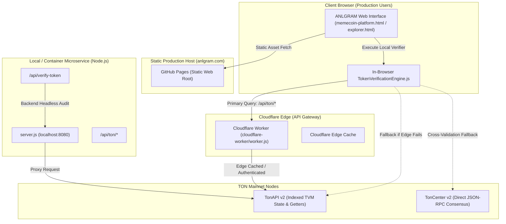

# ANLGRAM Verification Engine — Production Architecture & Topology

**Version**: 2.2.0
**Status**: Formal Architectural Specification
**Classification**: Engineering & Security Documentation

---

## 1. System Topology & Environments

ANLGRAM operates across three distinct execution environments:

### 1.1 Production Web Hosting (`anlgram.com`)
- **Hosting Provider**: GitHub Pages (configured via CNAME `anlgram.com`).
- **Deployment Pipeline**: [`.github/workflows/static.yml`](../../.github/workflows/static.yml) deploys the repository root as static assets on pushes to `main`.
- **Runtime**: **Static HTML/CSS/JS only**. There is **no Node.js server** executing at `anlgram.com`.
- **Implication**: Any endpoint implemented exclusively in `server.js` (such as `GET /api/verify-token` or `POST /api/upload-logo`) returns **HTTP 404** on `https://anlgram.com` unless intercepted and handled by an edge proxy.

### 1.2 Edge Proxy (`cloudflare-worker/worker.js`)
- **Runtime**: Cloudflare Workers (V8 isolates at edge).
- **Purpose**: Proxies TON blockchain API queries (`/api/ton/*`) while keeping the institutional `TONAPI_KEY` secure on the server side.
- **Allowed Endpoints**: Whitelisted read-only TonAPI routes, including account inspection, transactions, rates, jetton holders, and TVM getter method execution (`/blockchain/accounts/:id/methods/:method`).
- **Edge Security**: Enforces CORS, HTTP method restrictions (GET/OPTIONS only), query parameter whitelisting, and strict TON address format pre-validation.

### 1.3 Local / Microservice Server (`server.js`)
- **Runtime**: Node.js (v18+).
- **Purpose**: Local development server and standalone container microservice.
- **Features**: Serves local files, provides local proxy `/api/ton/*`, implements image upload staging `/api/upload-logo`, and exposes headless verification API `/api/verify-token`.

---

## 2. Dual-Mode Verification Architecture

The ANLGRAM Token Verification Engine ([`assets/js/token-verification-engine.js`](../../assets/js/token-verification-engine.js)) is written as an **Universal (Isomorphic) JavaScript Module**:

### Mode A: In-Browser Verification (Production Standard)
- **Used by**: [`memecoin-platform.html`](../../memecoin-platform.html), [`explorer.html`](../../explorer.html), [`assets/js/anl-labs.js`](../../assets/js/anl-labs.js).
- **Execution**: The browser executes `window.TokenVerificationEngine.verifyToken(address)` directly in the client's JS runtime.
- **Resilience**:
  1. Attempts primary query via relative proxy path `/api/ton/...`.
  2. If the proxy is unavailable (e.g., during static local file browsing or network failure), it falls back directly to public `https://tonapi.io/v2/...`.
  3. For secondary cross-validation, queries `https://toncenter.com/api/v2/getAddressInformation`.
- **Independence**: **Does not depend on `server.js` being online.**

### Mode B: Headless REST API (`server.js` `/api/verify-token`)
- **Used by**: Automated CLI auditors, external microservices, CI/CD regression tests.
- **Endpoint**: `GET /api/verify-token?address=<TON_ADDRESS>` or `POST /api/verify-token` with `{ "address": "..." }`.
- **Execution**: `server.js` imports `token-verification-engine.js` server-side, verifies the token on-chain, and responds with a JSON verification report.
- **Current Production Status**: Available locally and in containerized deployments. **Not exposed on `anlgram.com` static origin** until Cloudflare Worker route is bound to `/api/verify-token`.

---

## 3. Environment Variables & Secret Hygiene

| Variable | Scope | Target Environment | Purpose | Sensitivity |
| :--- | :--- | :--- | :--- | :--- |
| `TONAPI_KEY` | Server / Worker | `server.js`, Cloudflare Worker | Authenticates upstream requests to TonAPI v2 to bypass rate limits. | **Confidential Secret**. Never expose to browser client or commit to Git. |
| `IMGUR_CLIENT_IDS` | Server | `server.js` | Comma-separated list of Imgur Client IDs for anonymous token logo CDN hosting. | **Public App ID**. Not an OAuth secret, but configurable via env. |
| `TESTNET_DEPLOYER_MNEMONIC` | Local Tooling | `minter-contract/.env.testnet` | Testnet-only wallet mnemonic used for deploying staking router on Testnet (-3). | **Testnet Secret**. Strictly ignored by Git via `.gitignore`. |

---

## 4. Input Validation & Error Specification

All verification endpoints enforce pre-flight input validation before making any external network requests:

1. **Address Format Validation**:
   - Must match TON raw format `^(-1|0):[0-9a-fA-F]{64}$` OR friendly base64url format `^[A-Za-z0-9_-]{48}$`.
   - Maximum length: 128 characters.
   - Failure response: `HTTP 400 Bad Request` with `{ "error": "Invalid TON address parameter format...", "status": 400 }`.
2. **Rate Limiting**:
   - `server.js`: Max 120 requests per 60 seconds per client IP. Response: `HTTP 429 Too Many Requests`.
3. **Payload Limit**:
   - Maximum POST body size: 64 KB for JSON verification requests, 10 MB for logo upload.
