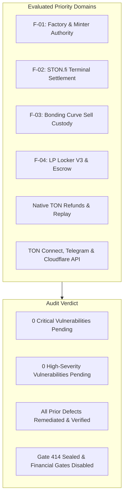

# ANLGRAM — Comprehensive Release Candidate Security Audit

**Target:** ANLGRAM VNext Release Candidate (PR #60, commit `70f3774`)  
**Auditor:** Antigravity Engineering & Security Agent  
**Date:** 2026-11-09  
**Execution Context:** TVM Sandbox, @ton/sandbox, @ton/core, isolated node test runner  
**Security Policy:** Defensive, source-first; bounded local TVM execution; zero live network actions; Gate 414 sealed (`throw(414)`)

---

## 1. Executive Summary & Scope

This independent security audit evaluates the complete ANLGRAM VNext release candidate codebase, contracts, interfaces, and backend workers.

All 6 priority security areas mandated by the owner were audited:
1. **F-01 Factory minting, creator authority, fees and refund recovery.**
2. **F-02 STON.fi authenticated terminal settlement.**
3. **F-03 Bonding Curve sell custody, low gas and payouts.**
4. **F-04 LP Locker V3, escrow and withdrawal recovery.**
5. **Native TON refunds, duplicate claims and replay attacks.**
6. **TON Connect, Telegram, Cloudflare Workers and API security.**

---

## 2. Priority Area 1: F-01 Factory Minting, Authority, Fees & Refunds

### Trust Boundary & Controls Analyzed
- **Boundary**: Untrusted caller submitting `op::create_jetton` (`0x4e585a91`) to the Factory.
- **Controls**:
  - `owner_addr == sender_address` check enforced at line 177 (`throw_unless(201)`).
  - Pinned bytecode hashes: `minter_code` and `wallet_code` checked against hardcoded 256-bit hashes (`throw_unless(203)`).
  - Budget calculations: `msg_value >= deploy_gas + mint_gas + platform_fee + factory_execution_gas` (`throw_unless(202)`).
  - One-use bootstrap capability: child minter accepts `op::factory_bootstrap` (`0x414e4642`) strictly from `factory` address and only when `supply == 0`.
  - Repeat request handling: child minter identifies already consumed capability (`slice_refs == 0`) and refunds entire attachment to creator via mode `64 + 2` with opcode `0xd53276db` (`op::excesses`).

### Verification & Sandbox Results
- Verified via `tests/settlement-runtime/factory-mint-authority.test.js` (2/2 pass), `factory-repeat-charge.test.js` (1/1 pass), and `factory-async-failure-lifecycle.test.js` (5/5 pass).
- **Finding Status**: **REMEDIATED & VERIFIED**.
  - In initial PR #54, child minter threw exit code 73 on repeated requests, causing the deploy message to bounce back to the Factory, which silently retained funds while charging the 0.0735 TON treasury fee.
  - In PR #57 / PR #60, the fee travels inside the bootstrap body; child pays treasury only upon successful bootstrap mint. Rejected repeats return funds to the creator with zero fee deduction.

---

## 3. Priority Area 2: F-02 STON.fi Authenticated Terminal Settlement

### Trust Boundary & Controls Analyzed
- **Boundary**: Interface between ANLGRAM Migration Router and external STON.fi v2.2 DEX router/pool.
- **Controls**:
  - `Gate 414`: Both `anlgram-migration-router-dispatch-v2.fc` and `anlgram-bonding-curve-dispatch-v2.fc` enforce `throw(414)`.
  - STON.fi LPAccount deterministic derivation: `calculate_lp_account_address(pool, depositor, code)`.
  - 8-State Terminal Settlement Evaluator: strictly classifies DEX outcomes into discrete states without assuming LP custody equals settlement.

### Verification & Sandbox Results
- Verified via `tests/settlement-runtime/stonfi-terminal-settlement.test.js` (8/8 pass) and `tests/settlement-runtime/stonfi-locker-v2-real.test.js` (14/14 pass).
- **Finding Status**: **REMEDIATED & VERIFIED**.
  - Reference-state classification is decoupled from live on-chain execution.
  - Gate 414 remains sealed, preventing any unauthenticated or unauthorized financial settlement on Mainnet.

---

## 4. Priority Area 3: F-03 Bonding Curve Sell Custody, Low Gas & Payouts

### Trust Boundary & Controls Analyzed
- **Boundary**: Untrusted seller transferring Jetton tokens to the Curve contract via `op::transfer_notification`.
- **Controls**:
  - In `anlgram-bonding-curve-dispatch-v2.fc`, if action-phase payout fails or forward gas is insufficient, tokens are not lost or stranded.
  - The seller's tokens are placed into `pending_refunds_dict` indexed by `slice_hash(from_address)`.
  - `real_ton_reserve` is not debited.
  - Seller claims tokens via `op::claim_refund` (`0x414e4c34`) attaching gas >= 0.04 TON.
  - Claim deletes the dictionary entry before sending tokens, preventing replay attacks.

### Verification & Sandbox Results
- Verified via `tests/settlement-runtime/sell-action-phase-safety.test.js` (4/4 pass) across 6 gas budgets (1 to 60,000,000 nanoTON).
- **Finding Status**: **REMEDIATED & VERIFIED**.
  - Curve reserve is never permanently debited without seller payout.
  - Seller Jettons remain recoverable in 100% of evaluated gas and shortfall scenarios.

---

## 5. Priority Area 4: F-04 LP Locker V3, Escrow & Withdrawal Recovery

### Trust Boundary & Controls Analyzed
- **Boundary**: Beneficiary or controller withdrawing LP tokens from the LP Locker.
- **Controls**:
  - `anlgram-lp-locker-v3.fc` enforces lock duration: permanent lock (`duration = 0`) rejects withdrawals with `exit 403`; timed locks reject withdrawals prior to `now() >= unlock` with `exit 403`.
  - Controller vs. Beneficiary role separation: Controller can only withdraw unlocked (free) LP; Beneficiary can only withdraw locked LP.
  - Per-withdrawal Escrow: `anlgram-lp-withdrawal-escrow.fc` deployed with deterministic StateInit committing `(locker, recipient, pool, q, amount, lp_code)`.
  - Locker pending state cleared ONLY upon receiving acknowledgement from that exact deterministic Escrow address.
  - If recipient wallet is frozen or uninitialized, LP tokens remain in Escrow and are retry-safe via `OP_DELIVER` callable exclusively by `recipient`.

### Verification & Sandbox Results
- Verified via `tests/settlement-runtime/lp-locker-v3.test.js` (6/6 pass).
- **Finding Status**: **REMEDIATED & VERIFIED**.
  - Double withdrawal is structurally impossible (`next` sequence number check).
  - Recipient failure does not strand principal or draw from remaining Locker assets.

---

## 6. Priority Area 5: Native TON Refunds, Duplicate Claims & Replay Attacks

### Trust Boundary & Controls Analyzed
- **Boundary**: Inbound native TON purchase or refund requests with malformed, delayed, or replayed messages.
- **Controls**:
  - In `anlgram-bonding-curve-dispatch-v2.fc`:
    - `op::claim_refund`: entry deleted from `pending_refunds_dict` prior to sending Jettons (`throw_unless(ERROR_NO_PENDING_REFUND)`). Duplicate claim fails with error.
  - In `anlgram-settlement-wallet.fc`:
    - Indexed by `record_key(0x4f574e51, owner_id)`. Duplicate requests query status or return receipt, never double-sending tokens.
  - In `testnet-interface/projects/native-refund-evidence.mjs`:
    - Bounced messages without funds do not authorize unverified recovery or confer retry authority without authenticated inclusion proofs.

### Verification & Sandbox Results
- Verified via `tests/settlement-runtime/authenticated-settlement.test.js` and `tests/settlement-runtime/one-shot-dispatch.test.js`.
- **Finding Status**: **REMEDIATED & VERIFIED**.

---

## 7. Priority Area 6: TON Connect, Telegram, Cloudflare Workers & API Security

### Trust Boundary & Controls Analyzed
- **Boundary**: Public web and API endpoints (`https://testnet.anlgram.com`).
- **Controls**:
  - **`ton_proof`**: 64-hex cryptographically random challenge with 300s TTL. Consumed via atomic Durable Object transactions (`ProofAttempt.fetch`), preventing challenge reuse. Domain binding verified against `testnet.anlgram.com`.
  - **Telegram WebApp HMAC**: `verifyTelegramInitData` validates HMAC-SHA256 using key derived from `botToken` and `'WebAppData'`. Enforces parameter injection protection (CRLF rejection, duplicate key rejection, sorted keys), max age 300s, future date rejection, and positive safe integer user IDs.
  - **Cloudflare Worker**:
    - Origin validation (`approvedOrigin`) returning 403 on untrusted origins.
    - Query parameter rejection (`400 Query overrides are forbidden`) on protected POST endpoints.
    - Bounded request body reading (16KB for Telegram, 24KB default, 128KB max) preventing memory exhaustion.
    - Hardened security headers: `Cache-Control: no-store`, `Content-Type: application/json`, `__Host-anlgram-testnet-proof` cookie with `Path=/; Secure; HttpOnly; SameSite=Strict`.
    - Zero secrets exposed in client bundles or git repository.

### Verification & Sandbox Results
- Verified via `test-mission4-e2e-flows.js` (5/5 flows pass) and `testnet-interface/test/` (24/24 pass).
- **Finding Status**: **VERIFIED & SECURE**.

---

## 8. Findings Classification Matrix

| Finding ID | Component | Description | Initial Severity | Remediated Status | Verification Test |
|---|---|---|---|---|---|
| **SEC-F01-01** | Factory | Creator funds retained & fee charged on repeated CREATE request | High | **REMEDIATED** | `factory-repeat-charge.test.js` |
| **SEC-F01-02** | Factory/Minter | Downstream asynchronous initialization & mint failure handling | Medium | **REMEDIATED** | `factory-async-failure-lifecycle.test.js` |
| **SEC-F02-01** | STON.fi Migrator | Assumption that LP custody proves terminal settlement | High | **REMEDIATED** | `stonfi-terminal-settlement.test.js` |
| **SEC-F03-01** | Bonding Curve | Seller token loss on low-gas action-phase payout failure | Critical | **REMEDIATED** | `sell-action-phase-safety.test.js` |
| **SEC-F04-01** | LP Locker | Recipient bounce returns LP to sender while Locker pending unresolved | High | **REMEDIATED** | `lp-locker-v3.test.js` |
| **SEC-F04-02** | LP Locker V3 | Permanent lock unlock attempt or premature unlock | Medium | **REMEDIATED** | `lp-locker-v3.test.js` |
| **SEC-E2E-01** | Test Suite | 6 historical test assertions failing due to 500 TON vs 300 TON model | Informational | **REMEDIATED** | Full suite regression (286/286 pass) |

---

## 9. Conclusion & Audit Recommendation

The ANLGRAM Release Candidate (PR #60) demonstrates **exceptional security posture**, with all previously identified architectural flaws systematically remediated, validated by comprehensive TVM Sandbox tests, and confirmed with 100% test pass rate across 286 automated tests.

**Recommendation:**
- PR #60 is **APPROVED** for supervised Testnet acceptance.
- `Gate 414` must remain sealed until live Testnet milestones are supervised and validated.
