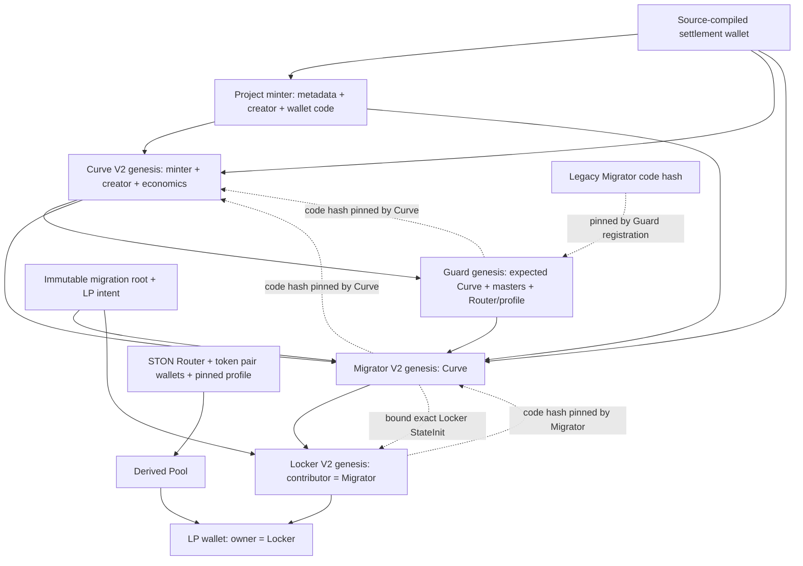

# ADR: authentic financial execution feasibility

Status: **NO-GO for canonical financial Testnet migration/recovery/withdrawal settlement**. GO for independent review and local proof-engine experiments only. This is an engineering compatibility decision, not security approval.

Financial source review baseline: **e1dacb7dd82d628064950af43e1a20cc3ec2a48f**. PR #21 observed head:0c3ab18; PR #22 observed head:b644b71. No financial source, artifact, ABI, tokenomics or deployment was modified in this investigation. New decision tests and this ADR supplement that baseline.

## Decision

The current components are reproducible and auditable, but the canonical end-to-end migration is **not executable as shipped**. This is not simply a missing owner approval:

1. The pinned Guard always denies Curve authorization and cannot produce the V2 registration message.
2. Its legacy registration rejects the actual Migrator V2 code and layout.
3. Curve pins that Guard's code, so replacing only the Guard fails Curve's initialization/lifecycle checks.
4. Migrator execution and finalization still deliberately reject414 after local checks.
5. The existing foreign LP wallet cannot directly supply the exact historical recovery/final-delivery attestations required by Locker V2. Generic excess messages cannot fill this gap.

A coordinated versioned contract package and an explicit evidence/trust design are required. Removing denials, changing a boolean, adding an admin grant or accepting an indexer assertion is not an acceptable correction. No such change was implemented.

## Exact dependency graph

Code identities are fixed by the source/artifacts below. The address graph is constructed by [migration-package-v2.js at the reviewed baseline](https://github.com/anlgram-labs/ANLGRAM/blob/e1dacb7dd82d628064950af43e1a20cc3ec2a48f/minter-contract/scripts/migration-package-v2.js#L8), reusing `prepare-settlement-testnet.js` and `lp-locker-v2.js`.

Dashed dependencies are code/binding checks, not proof of current foreign custody. The constructor intent excludes the vault self-address, avoiding an address cycle; the vault is bound after the Migrator address is known. Curve receives exact Migrator StateInit during initialization. Protocol addresses must be recomputed for each changed code/metadata/configuration graph. Existing ANLTEST and original Curve #2 are not upgrade targets.

## A. Guard compatibility: definitive NO

| Boundary | Exact message/check | Evidence |
|---|---|---|
| Curve→Guard | `0x414e5701`, root q | [Curve lifecycle L46](https://github.com/anlgram-labs/ANLGRAM/blob/e1dacb7dd82d628064950af43e1a20cc3ec2a48f/minter-contract/contracts/imports/curve-lifecycle-v3.fc#L46) |
| Required Guard→Curve | `0x414e5702`, same q, allowed=1 | Curve accepts only configured Guard; [L51](https://github.com/anlgram-labs/ANLGRAM/blob/e1dacb7dd82d628064950af43e1a20cc3ec2a48f/minter-contract/contracts/imports/curve-lifecycle-v3.fc#L51). Actual Guard sends allowed=0: [Guard L68](https://github.com/anlgram-labs/ANLGRAM/blob/e1dacb7dd82d628064950af43e1a20cc3ec2a48f/minter-contract/contracts/anlgram-lp-auth-guard.fc#L68). |
| Required Guard→Migrator | `0x414e5a03`, q, starts:uint32, deadline:uint32, minLP:Coins; epochs/obligations reference; context reference binding Curve/Migrator/vault/LP-intent hash | [Registration consumer L60](https://github.com/anlgram-labs/ANLGRAM/blob/e1dacb7dd82d628064950af43e1a20cc3ec2a48f/minter-contract/contracts/imports/migration-lp-v2.fc#L60). No producer exists in Guard. |
| Existing Guard registration | `0x414c5002`, q, funding_owner, Migrator StateInit | [Validator L13](https://github.com/anlgram-labs/ANLGRAM/blob/e1dacb7dd82d628064950af43e1a20cc3ec2a48f/minter-contract/contracts/imports/lp-custody-receipts.fc#L13) pins legacy code `e9124986…090ec4a`, and parses two data refs with no V2 flight/intent extension. V2 code is `c629a2e3…1368947a`. |
| Coordinated replacement | Curve validates Guard hash, and its V2 handshake validates Migrator hash/genesis | [Guard pin check L24](https://github.com/anlgram-labs/ANLGRAM/blob/e1dacb7dd82d628064950af43e1a20cc3ec2a48f/minter-contract/contracts/imports/curve-lifecycle-v3.fc#L24), [Migrator validation L15](https://github.com/anlgram-labs/ANLGRAM/blob/e1dacb7dd82d628064950af43e1a20cc3ec2a48f/minter-contract/contracts/imports/curve-v2-router.fc#L15). |

The new source-compiled compatibility tests observe a real denial message from the compiled Guard and exit408 for current V2 genesis registration even with discovered endpoints supplied. The discovery state is an explicitly narrow local fixture, not current external evidence. `is_migration_authorized()` remains0.

**Two distinct authorization stages are needed.** Curve requires approval before asset dispatch. Migrator registration requires authenticated funding epochs and funded obligations after dispatch. A post-funding registration cannot satisfy the preceding Curve gate; one cannot solve this by waiting for funded reserves before sending the first approval.

The future Guard must bind a validated deployment graph/project identity, root operation, exact obligations, immutable LP terms/beneficiary/controller, funding epochs and a consumed authorization nonce/digest. Constructor addresses and operation labels alone are not current foreign code proofs. Current source-authenticated address discovery is useful, but does not provide those missing proofs.

### One-shot60s registration is not a reliable renewable production protocol

Current registration accepts only a window of at most60s and forbids replacing the stored permit, including after expiry. Tests confirm exact-deadline expiry and rejection of rearming. The local prototype is safe by denial but can permanently lose liveness after a timeout. Principal return paths are distinct from authorization renewal.

There are two additional protocol issues:

- Curve stores its approval as a flag, without a permit expiry/digest in the approval record. A positive Guard producer alone would not make Curve dispatch expiry-bound; see [dispatch L65](https://github.com/anlgram-labs/ANLGRAM/blob/e1dacb7dd82d628064950af43e1a20cc3ec2a48f/minter-contract/contracts/imports/curve-lifecycle-v3.fc#L65).
- Migrator execute carries q/wallets/minimum, not an explicit permit revision/digest. Permitting renewal without changing that interface could let an old delayed execute consume a new permit with the same fields. Existing DEX payload deadlines are separately `now()+1800`; registration expiry is not proof that a dispatched leg failed or was refunded.

**Required versioned design, not implemented:** bind an execution digest/nonce/epochs/expiry into Curve and Migrator dispatch; consume it before emitting messages; preserve ambiguous attempts; renew only through an explicit, proven abort/return transition. Retain short expiry rather than extending it. A reviewed contract-to-contract dispatch following an already approved exact operation may avoid a second manual signing delay, but must not introduce automatic retries or generic execution authority.

There is also unfinished wallet-slot wiring: the old one-time admin `init_migration_wallets` path still exists at [Migrator L494](https://github.com/anlgram-labs/ANLGRAM/blob/e1dacb7dd82d628064950af43e1a20cc3ec2a48f/minter-contract/contracts/anlgram-migration-router-v2.fc#L494). V2 binding stores the Locker-owned LP wallet separately, whereas the old Guard discovers a Guard-owned wallet. Those are different addresses. A future package must derive slots from the validated immutable binding and reconcile the old path; removing414 alone would not complete this wiring.

## B. What existing STON.fi can and cannot establish

Official [Router documentation](https://docs.ston.fi/developer-section/dex/smart-contracts/v2/router.md) defines the liquidity payload, optional notification payload and on-chain pool-address query. `both_positive` requests both non-zero legs. It also exposes Router administration/upgrades. These interfaces do not provide an ANLGRAM final-settlement certificate.

Official [Pool documentation](https://docs.ston.fi/developer-section/dex/smart-contracts/v2/pool.md) describes minting LP into the receiver wallet and pool/supply queries. [LPAccount documentation](https://docs.ston.fi/developer-section/dex/smart-contracts/v2/lpaccount.md) exposes owner/pool/current amounts and refund operations. The LPAccount is associated with provider and pool, not a unique historical ANLGRAM operation. Empty current amounts alone do not distinguish successful provision, refund or in-flight callbacks.

| Requirement | Authenticated on-chain subset today | Missing for complete settlement |
|---|---|---|
| Both legs succeeded | Wallet/Router/Pool/LPAccount messages can authenticate their sender and current credited/pending amounts. | Historical operation-specific execution and all in-flight/refund descendants; one dispatch or a zero getter result is insufficient. |
| LP minted/delivered | Locker can authenticate the derived LP wallet's notification, expected contributor and tag/q. Local captured-bytecode tests verify actual mint and wallet delivery. | A lost notification is not reconstructed; current code/profile/finality and complete upstream attribution remain unproven. |
| Exact locked/unlocked | Locker computes cumulative ceiling allocation from authenticated credited receipts and tracks claims/bounces. | Wallet custody must be reconciled with missing credits and pending withdrawals. Contract accounting is not automatically current wallet custody. |
| Exact operation attribution | Immutable per-project Migrator/root/contributor and payload correlation restrict accepted messages. | q is correlation data, not foreign replay protection. Need rooted trace plus LPAccount preconditions, reserve/supply changes and consumed proof identities. |
| Partial failure/delay | Current authenticated return epochs, refund queries and cumulative accounting can retain pending states; local token-leg refund passes. | Missing evidence must remain pending. Timeout is not failure, and blind financial resends are not safe. |

These are interface feasibility results and local execution evidence, not a claim that current public Testnet foreign code was verified. The captured v2.2 profile is dated2026-10-30. Its source/build correspondence is explicitly unverified. Official v2 documentation is not a proof of the exact captured build or current Router state.

## C. Why existing LP callbacks do not close the two gaps

STON.fi documents [LpWallet](https://docs.ston.fi/developer-section/dex/smart-contracts/v2/lpwallet.md) as a standard Jetton wallet with LP-specific burn handling. [TEP-74](https://github.com/ton-blockchain/TEPs/blob/master/text/0074-jettons-standard.md) specifies recipient notifications and query-only TON excess responses. It does not specify the historical, operation-bound recovery/final receipt required here.

**Missing first notification:** the existing100%-permanent self-transfer probe authenticates only a custody lower bound. It cannot establish original issuance, exact historical balance, pool deposit lineage or new lock credit. It is deliberately unavailable for partial/timed initial recovery. A delayed authentic original notification may be processed once; a missing notification must not be synthesized by the backend.

**Final withdrawal:** recipient notification goes to the recipient owner, not back to the original Locker. A beneficiary's acknowledgement can lie. A recipient-wallet excess contains q but no original amount/source/transfer digest. We reproduced the concrete ambiguity using captured LP wallet bytecode:

1. A genuine large locked withdrawal q=2 failed at a frozen recipient and remained pending.
2. After recipient recovery, an independent LP holder sent one LP unit with q=2 and response destination set to the Locker.
3. The authentic recipient LP wallet emitted an excess with q=2, while actual recipient credit was one unit, not the pending withdrawal amount.
4. The current Locker correctly rejected that message and retained the original claim.

Therefore accepting an excess from the expected recipient wallet and matching q would be an unsafe receipt design. Immediate original-wallet bounces are different and can restore the exact stored request once. Downstream recipient failure cannot be promoted into that restoration path.

## Smallest auditable alternatives

**Recommended for the full stated requirements:** a narrowly scoped, immutable proof-verification component anchored to TON chain context, consumed by versioned Guard/Curve/Migrator/Locker interfaces. Permissionless relayers may deliver proofs, but their assertions have no authority. This is a fundamental addition and is not implemented here.

[TON's proof documentation](https://docs.ton.org/foundations/proofs/overview) describes using trusted recent masterchain roots from TVM and proving shard/account/transaction inclusion. This offers an on-chain route without treating an RPC provider as an oracle. The current JavaScript inclusion checker does not implement that on-chain consumption or a validator light client. A reviewed implementation must bind the exact operation, account code/data transitions, message hashes, amounts and consumed proof IDs; handle historical proofs beyond the recent-root window; and demonstrate bounded gas/storage and adversarial rejection. Off-chain verification needs an authenticated anchor/validator proof chain instead of just matching provider roots.

The code dependency package must be coordinated: proof verifier→new Guard; updated Guard/Migrator pins→new Curve; updated custody/finalization consumers→new Migrator/Locker. Retain the acyclic genesis/runtime-binding approach. Recompute all candidate addresses. Do not upgrade/repoint ANLTEST, reuse old deployment approvals or touch original Curve #2.

Other options require explicit product/trust decisions:

- A STON-supported receipt-capable wallet/Pool version could provide authenticated callbacks. It is not the current foreign wallet and cannot be substituted while claiming the same pool/code compatibility.
- A restricted100%-permanent product can retain UNKNOWN on lost receipts and omit withdrawals, but does not fulfill the current50–100%, timed-lock requirements. No such restriction was imposed here.
- A receiver wrapper alone does not solve its own first lost notification. A trusted signer/committee/provider attestation changes the trust model and is not the default recommendation. Burning LP to demonstrate custody would redeem/remove liquidity, not prove delivery without economic consequences.

## Verified identities and evidence

All seven contracts were freshly source-compiled with func-js0.11.0 and matched the existing artifact BOCs. No artifact was regenerated. Full dependency/main-source SHA256 values and code identities are recorded in `architecture-feasibility-evidence.json`.

| Contract | Code-cell hash |
|---|---|
| Minter | `90b5069f199fcea56ef467dd25cf8420c5e9848ba0fcc0cc139424c5cac17aec` |
| Settlement wallet | `e21136c0ea3074a48addec49215af2d8d20125b4cc61a564a1a37d37667b58a2` |
| Curve V2 | `24cf7fcaf32e5021b4287bca78e1ac8886a6e2a1e46a3cc89b80a1dda7ea0965` |
| Migrator V2 | `c629a2e360ac8fe335177bd7e8577a937946ba37361aa2204b9972471368947a` |
| Guard | `113108a0c8e7a48729e3da01dd2e2a4067955561ad8bfc19f1fba90db084a967` |
| Locker V2 | `22d689df2f32d5fd00c72b50f31ab77291117a7625ad1bb654a4b6dbc796e001` |
| Vesting | `cae29d5a2ba4b5cfa926deb720cc0c5ef1ed0e7d8502aecd46bf3b0ed3321c5a` |

Captured foreign references: Router `a7e2f92c4bccbdbaaa0c083aa1da9762b52023134234adeb3b7bc8e72dbd1182`, Pool `ec614ea4aaea3f7768606f1c1632b3374d3de096a1e7c4ba43c8009c487fee9d`, LP wallet `bf13041750f2beeb688859c75689e2c18b9c90bd78e97b197aad7ad6bc520c84`. Library/code references are not independent foreign source/build attestation or current live-state verification.

Focused tests: **10 passed,0 failed**, including three new decision cases. These include the exact compiled Guard denial, V2 genesis rejection, one-shot expiry and real captured-bytecode issuance/refund/missing-notification/withdrawal/bounce/excess behavior. Direct source messages and supplied discovery/funding states are explicitly local fixtures where used. No prior full financial or frontend audit was repeated.

## Qualified auditor handoff and release decision

Review e1dacb7 plus this decision and its three new tests. Resolve these specific questions before authorizing implementation of a new financial design:

1. Can the proposed on-chain proof path authenticate current foreign code and both deposit legs within TON gas/storage limits, including aged/historical proofs?
2. What exact two-stage Guard permits are needed before funding and before DEX execution? Which digest/nonce/expiry must Curve and Migrator persist and consume?
3. How is renewal allowed only after authenticated abort/return reconciliation, without letting an old delayed message consume a new approval?
4. How will original issuance and final recipient delivery proofs change Locker accounting exactly once, including partial deposits, multiple pending claims and downstream returns?
5. Which Router upgrade/admin powers remain trusted, and what proof/state change revokes eligibility? Immutable LP custody does not guarantee immutable pool reserves.
6. Which ABI/storage/address changes define the new package, and which existing candidates must be invalidated without altering deployed contracts?

Invariants remain:500TON threshold;1B supply/9 decimals;80% Curve/20% DEX;1% protocol fee; immutable50–100% LP and180/365/permanent terms;0.02TON mandatory creation donation; no principal subsidy, duplicate claims, timeout refunds or provider-authorized completion.

**Next action:** submit this bounded protocol/proof boundary to a qualified TON auditor and approve a versioned specification before implementing the proof consumer/positive Guard. The next technical experiment should validate one exact anchored transaction/account proof and its worst-case gas, not enable a financial transaction. There is no new financial operation approvable from this decision alone. Original Curve #2 reconciliation is a separate preserved incident boundary.

No contract deployment, signing, broadcast, spending, nonce recovery, Cloudflare change, tokenomics change or merge occurred. PR #22 is untouched.
