# ANLGRAM Launchpad — Phase 2C Pre-Flight Audit Report
## Production Safety, Testnet Deployment Readiness, and Real Transaction Verification

- **Document Version**: 1.0.0
- **Audit Date**: 2026-10-27T22:15:00-04:00
- **Audited Commit**: `aec082646834d75655c893820ca2bb4136762f78`
- **Active Branch**: `feature/launchpad-engine`
- **Rollback Branch**: `backup/pre-launchpad-phase1-2026-10-27` (`94b225587c9b55535df1d02716641b166271171d`)
- **Audit Verdict**: **`BLOCKED FOR LIVE TESTNET DEPLOYMENT`** (4 Critical/High Architectural Blockers Identified)

---

### EXECUTIVE SUMMARY

In accordance with Phase 2C requirements, an exhaustive source-level pre-flight readiness audit was performed on the compiled FunC contracts, deployment configuration, and TVM test harnesses.

While local compilation and pure TVM unit tests pass (40/40 TVM tests, 46/46 math tests), rigorous scrutiny of real TON message mechanics, asynchronous contract interactions, and live network compatibility revealed **four critical blockers** that make immediate testnet deployment unsafe.

Deploying without resolving these blockers would result in either permanent contract freezing, gas draining, or DEX migration failure on-chain.

| Category | Finding | Severity | Status |
| :--- | :--- | :--- | :--- |
| **Renounce Verification** | `jetton-minter.fc` opcode 3 emits no acknowledgement; curve activation lacks on-chain proof | **CRITICAL** | **BLOCKED** |
| **DEX Migration** | `anlgram-bonding-curve.fc` uses Tonstakers opcode `0x47d54391` instead of STON.fi v2 `0x37c096df` | **CRITICAL** | **BLOCKED** |
| **LP Locker Custody** | `anlgram-lp-locker.fc` dynamically binds to first sender; vulnerable to front-running DoS | **HIGH** | **BLOCKED** |
| **Gas Accounting** | Rejected sell refund draws 0.04 TON from contract reserve; vulnerable to gas-drain attack | **MEDIUM** | **BLOCKED** |
| **Testnet Threshold** | Mainnet 500 TON target is unachievable with testnet faucet balance (~2 TON) | **OPERATIONAL** | **MITIGATION DEFINED** |

---

## 1. REPOSITORY STATE AND ARTIFACT VERIFICATION

### 1.1 Branch and Commit Integrity
- **Active Branch**: `feature/launchpad-engine`
- **Current HEAD**: `aec082646834d75655c893820ca2bb4136762f78`
- **Production Baseline**: `94b225587c9b55535df1d02716641b166271171d`
- **Working Tree**: Clean (`git status --short` confirms zero uncommitted changes to tracked files).

### 1.2 Protection of 20 Production-Critical Files
All 20 protected production files were verified against commit `94b2255`. The diff is **exactly 0 bytes** across all files:
- `memecoin-platform.html` (Unchanged)
- `assets/js/launchpad.js` (Unchanged)
- `assets/js/wallet-connect.js` (Unchanged)
- `assets/js/api.js` (Unchanged)
- `assets/js/token-verification-engine.js` (Unchanged)
- `assets/js/security.js` (Unchanged)
- `assets/js/platform-analytics.js` (Unchanged)
- `assets/js/tonconnect-ui.js` (Unchanged)
- `assets/js/staking-pool.js` (Unchanged)
- `assets/js/token-scanner.js` (Unchanged)
- `assets/js/explorer.js` (Unchanged)
- `assets/js/main.js` (Unchanged)
- `minter-contract/contracts/jetton-minter.fc` (Unchanged)
- `minter-contract/contracts/jetton-wallet.fc` (Unchanged)
- `minter-contract/contracts/anlgram-staking-router.fc` (Unchanged)
- `minter-contract/contracts/anlgram-stake-vault.fc` (Unchanged)
- `cloudflare-worker/worker.js` (Unchanged)
- `cloudflare-worker/wrangler.toml` (Unchanged)
- `.github/workflows/deploy.yml` (Unchanged)
- `package.json` (Unchanged)

### 1.3 Compiler and BOC Verification
- **FunC Compiler**: `@ton-community/func-js` version `0.11.0` (FunC 0.4.4).
- **Bonding Curve Artifact**: `minter-contract/build/anlgram-bonding-curve.compiled.json`
  - Code Cell Hash (SHA-256): `d4fa8317d040a9a92c7ac81d3cecff65baf7cf571d6ad8a50d23878d9013fa26`
  - Base64 BOC Length: 3,028 bytes
- **LP Locker Artifact**: `minter-contract/build/anlgram-lp-locker.compiled.json`
  - Code Cell Hash (SHA-256): `29cc824b80d1f96c4b4a35042c1f756db4d302735f50c3eceb37157a9d6d26ae`
  - Base64 BOC Length: 716 bytes
- **Independent Build Reproduction**: Both compilers executed cleanly in Node.js v24.18.0 and produced bit-for-bit identical hashes.

---

## 2. INITIALIZATION AND RENOUNCE ACTIVATION AUDIT

### 2.1 The Renounce Transition Mechanism
In `anlgram-bonding-curve.fc`:
1. When the bonding curve receives the initial 1 Billion tokens via `transfer_notification` (`op == 0x7362d096`) while in `STATE_INITIALIZING`, it emits:
   ```func
   ;; Outbound message to Jetton Master: opcode 3 (change_admin)
   var msg_body = begin_cell()
       .store_uint(3, 32)
       .store_uint(query_id, 64)
       .store_uint(0, 2)  ;; addr_none
       .end_cell();
   ```
2. The curve sets its local state to `STATE_RENOUNCE_PENDING` (2).
3. The transition to `STATE_ACTIVE` (3) is triggered exclusively by `op::activate_trading` (`0x2ba21557`):
   ```func
   if (op == op::activate_trading) {
       throw_unless(ERROR_UNAUTHORIZED, equal_slices(sender_address, admin_address));
       throw_unless(ERROR_INVALID_STATE, state == STATE_RENOUNCE_PENDING);
       state = STATE_ACTIVE;
   }
   ```

### 2.2 Critical Vulnerability Analysis
- **Authorized Sender**: Solely `admin_address`.
- **On-Chain Verification**: **NONE**. The bonding curve contract performs zero on-chain checks to verify that `jetton-minter.fc` actually processed opcode 3 and set `admin_address` to `addr_none`.
- **Root Cause in `jetton-minter.fc`**: Line 135 of `jetton-minter.fc` terminates with `save_data(...)` and `return ();`. It sends **zero outbound message or event** back to the sender.
- **Consequence of Premature Activation**: If an off-chain keeper or admin sends `op::activate_trading` while the `change_admin` message bounced or was delayed in the validator queue, the curve transitions to `STATE_ACTIVE`. Trading begins on a Jetton whose minting authority has NOT been renounced!
- **Consequence of Offline Keeper**: If renunciation succeeds on-chain but the off-chain keeper crashes or is offline, the curve remains stuck in `STATE_RENOUNCE_PENDING` indefinitely, rejecting all buys.
- **TVM Simulation Artifact**: In `test-bonding-curve-tvm.js`, lines 185-194 simulate an off-chain admin calling `op::activate_trading`. In a live decentralized environment, this introduces a trusted centralized keeper without proof verification.

> [!CAUTION]
> **VERDICT: BLOCKED**. The launchpad cannot be deployed live until a trustless on-chain verification mechanism or an authenticated multi-step gate with cryptographic proof is established.

---

## 3. BUY, SELL, AND REFUND MESSAGE FLOW AUDIT

### 3.1 Buy Flow
- **Inbound Message**: `op::buy` (`0x5fcc3d14`) or plain comment (`op == 0`).
- **Required Value**: `msg_value > GAS_OVERHEAD_TRADE + 0.01 TON` ($> 0.05\text{ TON}$).
- **Fee Accounting**: $1.00\%$ ($100$ bps) deducted from gross input TON (`msg_value - 0.04 TON`).
- **Slippage Enforcement**: `tokens_out >= min_tokens_out`. If violated, TVM throws exit code 404 (`ERROR_SLIPPAGE_EXCEEDED`), bouncing incoming TON back to the sender.
- **Token Delivery**: Calls `send_jettons(curve_jetton_wallet, buyer, tokens_out, buyer, 0.01 TON)`.
- **Identified Gap**: If the buyer's Jetton Wallet deployment bounces (e.g., storage error), the bounce message reaches the curve, but `anlgram-bonding-curve.fc` line 180 ignores bounced messages (`if (flags & 1) return ();`). This leaves the curve's internal `real_token_reserve` permanently reduced without re-crediting the tokens.

### 3.2 Sell Flow
- **Authentication**: Line 238 strictly requires `equal_slices(sender_address, curve_jetton_wallet)`. Messages from unauthenticated wallets or direct callers are immediately rejected with exit code 401.
- **Seller Extraction**: Extracted from `from_address` in the `transfer_notification` body.
- **Minimum Output Protection**: Parsed from `forward_payload`. If `net_ton_out < min_ton_out`, the sale is rejected.
- **Solvency Guard**: If `gross_ton_out > real_ton_reserve`, the sale is rejected.

### 3.3 Critical Gas Subsidy Drain Vulnerability
When a sell order is rejected (slippage violation or curve not active), the contract executes line 277:
```func
send_jettons(curve_jetton_wallet, from_address, token_amount, from_address, 10000000);
```
In `send_jettons`:
```func
var msg = begin_cell()
    .store_uint(0x18, 6)
    .store_slice(jetton_wallet)
    .store_coins(40000000) ;; 0.040 TON attached for gas
    .store_uint(1, 1 + 4 + 4 + 64 + 32 + 1 + 1)
    .store_ref(msg_body);
send_raw_message(msg.end_cell(), 1); ;; Mode 1: pay fees separately from contract balance
```
- **The Vulnerability**: The incoming `transfer_notification` may only contain $0.01\text{ TON}$ of forwarded value. But `send_jettons` attaches $0.04\text{ TON}$ paid from the contract's own balance (`send_raw_message` Mode 1).
- **The Attack**: An attacker sells 1 unit of token with an impossible `min_ton_out` (e.g., 999,999 TON), attaching only $0.01\text{ TON}$ gas.
- **The Loss**: The contract pays $0.03\text{ TON}$ out of its reserve/storage to execute the refund. Repeating this 1,000 times drains $30\text{ TON}$ from the bonding curve!

> [!CAUTION]
> **VERDICT: BLOCKED**. The refund transaction must derive attached gas strictly from incoming message value (`msg_value`), or require a minimum forward TON amount ($\ge 0.05\text{ TON}$) on sells, refunding only within gas bounds.

---

## 4. TON RESERVE AND MIGRATION BUDGET RECONCILIATION

### 4.1 Storage Category Breakdown
1. **Real Curve TON Reserve (`real_ton_reserve`)**:
   - Represents 100% of the collateral backing un-graduated tokens.
   - At genesis: $0\text{ TON}$.
   - At graduation: Exactly $500\text{ TON}$ (mainnet) or $1.0\text{ TON}$ (testnet profile).
2. **Accrued Protocol Fees (`accrued_protocol_fees`)**:
   - Represents the cumulative $1\%$ trading fees.
   - Claimable only by `treasury_address` via `op::sweep_fees`.
3. **Contract Storage & Rent Buffer**:
   - Minimum required: $\approx 0.05\text{ TON}$ to avoid contract freezing.
   - Funded by initial contract deployment deposit.
4. **Migration Operational Budget**:
   - In `op::migrate_dex`, the contract sends:
     - Message 1: 200M tokens to DEX Router with $0.10\text{ TON}$ forward value and $0.04\text{ TON}$ gas.
     - Message 2: $500\text{ TON}$ liquidity principal to DEX Router with Mode 1 (fees paid separately).
   - **Total Outbound Operational Gas**: $\approx 0.16\text{ TON}$.
   - **Funding Source Gap**: Currently, the contract does not verify that the message triggering `op::migrate_dex` includes $\ge 0.20\text{ TON}$ to cover these operational costs. If `msg_value` is insufficient, the contract attempts to draw from its own balance, potentially failing with TVM exit code 37/38 (insufficient balance).

---

## 5. GRADUATION THRESHOLD & TESTNET CONFIGURATION

### 5.1 Mainnet vs. Testnet Threshold Architecture
- In `anlgram-bonding-curve.fc`, `graduation_threshold_ton` is **NOT** a hardcoded bytecode constant. It is loaded from `StateInit.data` cell reference 2.
- In `minter-contract/build/anlgram-bonding-curve.compiled.json`, the artifact records `thresholdTon: 500`.

### 5.2 Testnet Infeasibility with 500 TON
- The testnet deployer wallet holds $0.00\text{ TON}$.
- TON Testnet faucets dispense $1.0 - 2.0\text{ TON}$ per request.
- Fulfilling a $500\text{ TON}$ curve threshold on testnet requires 250+ faucet operations, which is completely unfeasible.

### 5.3 Dedicated Testnet Configuration Profile
To enable complete on-chain verification of the buy $\to$ sell $\to$ refund $\to$ graduation $\to$ LP lock lifecycle, a dedicated testnet configuration is required:

$$\begin{aligned}
T_{\text{grad}} &= 1.0\text{ TON} = 1,000,000,000\text{ nanoTON} \\
v_{\text{TON}} &= \frac{T_{\text{grad}}}{3} = 333,333,333\text{ nanoTON} \\
v_{\text{TOK}} &= \frac{800,000,000}{3} = 266,666,666.666\text{ tokens} \\
P_{\text{terminal}} &= \frac{1.0 + 0.333333333}{266,666,666.666} = 5.0\text{ nanoTON/token} \\
P_{\text{DEX}} &= \frac{1.0\text{ TON}}{200,000,000\text{ tokens}} = 5.0\text{ nanoTON/token} \\
\Delta P &= 0.000000\% \quad (\text{Exact Zero Price Discontinuity})
\end{aligned}$$

This preserves identical mathematical properties, identical zero-price-jump continuity, and identical FunC logic while allowing full verification using $2.0\text{ Testnet TON}$.

---

## 6. DEX COMPATIBILITY AND STON.FI V2 INTEGRATION AUDIT

### 6.1 Critical Protocol Mismatch in `anlgram-bonding-curve.fc`
Lines 481-488 of `anlgram-bonding-curve.fc` currently implement:
```func
var msg = begin_cell()
    .store_uint(0x10, 6)
    .store_slice(dex_router_address)
    .store_coins(ton_to_migrate)
    .store_uint(0, 1 + 4 + 4 + 64 + 32 + 1 + 1)
    .store_uint(op::deposit(), 32) ;; 0x47d54391 (Tonstakers deposit opcode!)
    .store_uint(query_id, 64);
send_raw_message(msg.end_cell(), 1);
```
- `0x47d54391` is the deposit opcode for Tonstakers liquid staking, **NOT** STON.fi!
- STON.fi v2 CPI Router does not have an `op::deposit()` opcode `0x47d54391`.

### 6.2 Official STON.fi v2.1 Protocol Specifications
Based on official STON.fi documentation and `@ston-fi/sdk`:
1. **Asset Routing Architecture**: In STON.fi v2, native TON is NOT deposited directly into the router. It must be wrapped as `pTON` (Proxy TON) or routed through the router's pTON Vault.
2. **Liquidity Provision Opcode**: The official opcode for providing liquidity is `op::provide_lp` (`0x37c096df`), NOT `0x47d54391`.
3. **Two-Asset Coordination**: Liquidity provision requires supplying both Jetton A (the token) and Jetton B (pTON) to the user's `LpAccount`. Once both assets arrive, the pool issues LP Jettons to `from_user` (the LP Locker).
4. **Current Status on Testnet**: STON.fi v2 testnet router address is `kQALh-JBBIKK7gr0o4AVf9JZnEsFndqO0qTCyT-D-yBsWk0v`.

> [!CAUTION]
> **VERDICT: BLOCKED**. Executing the current contract's DEX migration on testnet will fail on-chain, causing permanent loss of the 500 TON liquidity principal. The contract's migration routine must be rewritten to match STON.fi v2.1 specifications.

---

## 7. LP LOCKER CUSTODY AND SECURITY AUDIT

### 7.1 Source Code Inspection (`anlgram-lp-locker.fc`)
Lines 90-99:
```func
lp_amount_locked += jetton_amount;
is_locked = 1;

if (lp_wallet_address.preload_uint(2) == 0) {
    lp_wallet_address = sender_address;
} else {
    throw_unless(ERROR_UNAUTHORIZED_SENDER, equal_slices(sender_address, lp_wallet_address));
}
```

### 7.2 Critical Front-Running Vulnerability
1. When `anlgram-lp-locker.fc` is deployed, `lp_wallet_address` is initialized to `addr_none` (`preload_uint(2) == 0`).
2. An attacker can observe the locker deployment on the blockchain.
3. The attacker transfers 1 unit of an arbitrary worthless Jetton to the locker.
4. The locker receives `transfer_notification` from the attacker's Jetton wallet.
5. Because `lp_wallet_address` is uninitialized, the locker **permanently binds** `lp_wallet_address` to the attacker's Jetton wallet!
6. Later, when the DEX migration executes and the genuine STON.fi LP Jettons arrive, line 98 checks `equal_slices(sender_address, lp_wallet_address)`.
7. The genuine LP tokens are rejected with exit code 401 (`ERROR_UNAUTHORIZED_SENDER`), bouncing or getting stuck.
8. The launchpad's liquidity proof is compromised.

### 7.3 Withdrawal Logic Verification
- Permanent Lock: Line 129 enforces `throw_if(ERROR_LOCK_ACTIVE, unlock_timestamp == 0xFFFFFFFFFFFFFFFF);`.
- This ensures that once valid LP tokens are locked, no withdrawal, transfer, burn, or administrative escape path exists.
- The lock getter `get_lock_data()` accurately reflects state.

> [!CAUTION]
> **VERDICT: BLOCKED**. The LP Locker must require `lp_wallet_address` to be authenticated (e.g., initialized explicitly by admin/curve factory or derived deterministically from `expected_lp_minter`) before accepting any deposits.

---

## 8. TESTNET DEPLOYER AUDIT & NETWORK SAFETY

### 8.1 Address Derivation and Verification
- Configured file: `minter-contract/.env.testnet`
- Key present: `TESTNET_DEPLOYER_MNEMONIC`
- Wallet version: `WalletContractV4` (workchain 0)
- Derived Raw Address: `0:73431e9265af786a888915f6873d5f9c275115f98ef87633442b0bf567918e9f`
- Derived Testnet Bounceable: `kQBzQx6SZa94aoiJFfaHPV-cJ1EV-Y74djNEKwv1Z5GOn06-`
- Derived Testnet Non-Bounceable: `0QBzQx6SZa94aoiJFfaHPV-cJ1EV-Y74djNEKwv1Z5GOnxN7`

### 8.2 Live Network Query Verification
Querying live TON Testnet via `assets/js/blockchain-provider.js` using TonAPI v2:
- Status: `nonexist`
- Balance: `0 nanoTON` (`0.000000000 TON`)
- Network: `testnet`
- Explorer: `https://testnet.tonviewer.com/kQBzQx6SZa94aoiJFfaHPV-cJ1EV-Y74djNEKwv1Z5GOn06-`

### 8.3 Network Isolation & Credential Safety
- Hard-gated network checks: The deployment scripts must verify `process.env.NETWORK === 'testnet'` and abort if the endpoint is mainnet.
- Credential isolation: `TESTNET_DEPLOYER_MNEMONIC` is isolated in `minter-contract/.env.testnet` (listed in `.gitignore`).
- Zero Leakage: No mnemonic or private key has been printed, logged, or checked into Git.

---

## 9. COMPREHENSIVE 20-STEP TESTNET TRANSACTION PLAN

When the blockers are resolved and the testnet wallet is funded, execution will proceed strictly along this verifiable 20-step plan:

```mermaid
flowchart TD
    Step1["1. Deploy LP Locker"] --> Step2["2. Verify Locker On-Chain"]
    Step2 --> Step3["3. Deploy Bonding Curve"]
    Step3 --> Step4["4. Verify Curve On-Chain"]
    Step4 --> Step5["5. Deploy Jetton Master"]
    Step5 --> Step6["6. Mint 1B Supply & Deposit to Curve"]
    Step6 --> Step7["7. Initialize Curve (op::init_launchpad)"]
    Step7 --> Step8["8. Verify Renounce & Trading Gate"]
    Step8 --> Step9["9. Real Testnet Buy (0.2 TON)"]
    Step9 --> Step10["10. Verify Buyer On-Chain Jetton Balance"]
    Step10 --> Step11["11. Real Testnet Sell"]
    Step11 --> Step12["12. Verify Seller On-Chain TON Payout"]
    Step12 --> Step13["13. Test Slippage Violation & Verify Jetton Refund"]
    Step13 --> Step14["14. Verify Exact Reserve Accounting"]
    Step14 --> Step15["15. Test Unauthorized Call Rejections"]
    Step15 --> Step16["16. Buy to Trigger Graduation (1.0 TON Target)"]
    Step16 --> Step17["17. Real STON.fi v2.1 DEX Migration"]
    Step17 --> Step18["18. Verify DEX Pool Creation"]
    Step18 --> Step19["19. Verify LP Tokens Received by Locker"]
    Step19 --> Step20["20. Verify Immutable Lock Getter On-Chain"]
```



| Step | Action | Contract Target | Verification Standard | Explorer Verification |
| :---: | :--- | :--- | :--- | :--- |
| **1** | Deploy LP Locker | New Locker Contract | Code hash matches compiled BOC | Tonviewer tx link |
| **2** | Verify Locker State | Locker Contract | `is_locked == 0`, `unlock == 0xFF..FF` | RPC Getter call |
| **3** | Deploy Bonding Curve | New Curve Contract | Code hash matches compiled BOC | Tonviewer tx link |
| **4** | Verify Curve State | Curve Contract | `state == 0 (UNINITIALIZED)`, `reserve == 0` | RPC Getter call |
| **5** | Deploy Testnet Jetton Master | Jetton Minter | `total_supply == 0`, `admin == deployer` | Tonviewer tx link |
| **6** | Mint 1B Tokens | Jetton Minter $\to$ Curve | Curve Jetton Wallet receives exactly 1B | Jetton Wallet balance |
| **7** | Initialize Launchpad | Curve Contract | `op::init_launchpad` transitions to initializing | Tonviewer tx link |
| **8** | Renounce & Gate Verification | Jetton Minter & Curve | Minter admin is `addr_none`; trading activated | RPC Jetton Data call |
| **9** | Execute Testnet Buy | Curve Contract | Attach 0.20 TON; curve receives net TON | Tonviewer tx link |
| **10** | Verify Buyer Balance | Buyer Jetton Wallet | Buyer wallet deployed, tokens received | RPC Jetton Wallet call |
| **11** | Execute Testnet Sell | Curve Contract | Sell tokens via `transfer_notification` | Tonviewer tx link |
| **12** | Verify TON Payout | Seller Wallet | Seller receives net TON payout | Account balance diff |
| **13** | Slippage Refund Test | Curve Contract | Send sell with impossible min TON; tokens refunded | Jetton Wallet balance |
| **14** | Reserve Accounting Check | Curve Contract | `real_ton_reserve + fees == physical_balance` | RPC Getter verification |
| **15** | Security Rejection Test | Curve Contract | Send unauthenticated sweep/withdraw; exit $\ne 0$ | TVM Revert code |
| **16** | Trigger Graduation | Curve Contract | Buy to hit $1.0\text{ TON}$ testnet threshold | `state == 4 (GRAD_PENDING)` |
| **17** | STON.fi v2.1 Migration | Curve $\to$ STON.fi | Emits valid STON.fi `provide_lp` payload | Outbound message inspection |
| **18** | Verify DEX Pool | STON.fi Pool Contract | Pool initialized with 1.0 TON + 200M tokens | STON.fi Explorer / Tonviewer |
| **19** | Verify LP Deposit | Locker Contract | STON.fi LP tokens deposited to Locker | Locker Jetton balance |
| **20** | Verify Permanent Lock | Locker Contract | `is_permanently_locked() == -1` | On-Chain Getter verification |

---

## 10. COST ESTIMATION & AUDIT VERDICT

### 10.1 Required Testnet Balance & Expected Costs
- **Locker Deployment**: $\approx 0.05\text{ TON}$
- **Bonding Curve Deployment**: $\approx 0.08\text{ TON}$
- **Curve Storage Rent Deposit**: $\approx 0.10\text{ TON}$
- **Jetton Master & Wallet Deployment**: $\approx 0.10\text{ TON}$
- **Curve Initialization & Renounce**: $\approx 0.05\text{ TON}$
- **Trading Lifecycle Tests (Buys/Sells/Refunds)**: $\approx 0.40\text{ TON}$
- **Graduation Reserve Funding (Testnet Profile)**: $\approx 1.00\text{ TON}$
- **DEX Migration & LP Lock Gas**: $\approx 0.40\text{ TON}$
- **Safety Gas Buffer**: $\approx 0.32\text{ TON}$
- **Total Recommended Testnet Wallet Funding**: **$2.50\text{ TON}$**

### 10.2 Final Audit Verdict

```
═══════════════════════════════════════════════════════════════════════════
🔴 AUDIT VERDICT: BLOCKED FOR LIVE TESTNET DEPLOYMENT
═══════════════════════════════════════════════════════════════════════════
Reason: 4 Critical/High architectural defects identified in smart contracts:
  1. Renounce activation lacks cryptographic on-chain verification.
  2. STON.fi v2 DEX migration uses incompatible Tonstakers opcode (0x47d54391).
  3. LP Locker allows front-running token binding denial-of-service.
  4. Sell refund routine allows drain of contract TON reserves.
═══════════════════════════════════════════════════════════════════════════
```

### 10.3 Mandatory Next Steps Before Any Testnet Broadcast
1. Author remediation patches for `anlgram-bonding-curve.fc` and `anlgram-lp-locker.fc` on `feature/launchpad-engine`.
2. Recompile FunC contracts and update build artifacts.
3. Update and pass all TVM simulation tests with the corrected STON.fi v2.1 payloads and LP locker protection.
4. Obtain explicit approval and proceed with funded testnet validation.
