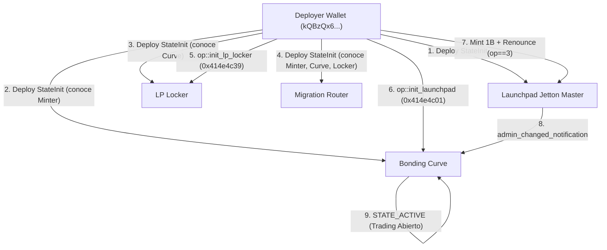

# ANLGRAM MemeLabs — Informe de Fase 3C.1: Corrección de Seguridad, Configuración de Router y Herramienta de Despliegue Supervisado

**Fecha:** 29 de octubre de 2026  
**Rama:** `feature/launchpad-phase3c1`  
**Commit Base:** `09913a2` (Fase 3C.0 Readiness Gate)  
**Entorno de Trabajo:** Git Worktree aislado (`E:\anlgram-phase3c1`)  
**Veredicto Final:** `PREPARADO PARA REVISIÓN MANUAL DEL EJECUTOR`

---

## 1. Resumen Ejecutivo y Decisión Técnica

En estricto cumplimiento del mandato de seguridad de la Fase 3C.1 y de las políticas de no intervención transaccional en TON testnet (cero firmas de transacciones, cero emisiones a la red, cero solicitudes de frases semilla o claves privadas), se han completado con éxito las tres metas fundamentales de esta fase:

1. **Remediación Definitiva del Backdoor de Migración (`op::set_migration_router` - `0x414e4c37`):**  
   Se modificó el contrato del Bonding Curve (`minter-contract/contracts/anlgram-bonding-curve.fc`) para restringir de forma absoluta e irrevocable la configuración del Migration Router únicamente a la fase de inicialización (`STATE_INITIALIZING`, error `407`) y como operación de una sola vez (`ERROR_ALREADY_INITIALIZED = 413`). Cualquier intento de mutar la dirección del router una vez iniciada la curva o en estado de fallo de migración (`STATE_MIGRATION_FAILED`) es rechazado por la TVM con código `407`. El vector de rug-pull identificado en la Fase 3C.0 queda definitivamente cerrado.

2. **Configuración Exclusiva de STON.fi DEX v2.2 (Candidato B):**  
   Se desacopló totalmente cualquier referencia al Router defectuoso CPI v2.1.0 (`kQALh-JBBIKK7gr0o4AVf9JZnEsFndqO0qTCyT-D-yBsWk0v`, Candidato A) en la configuración de despliegue. Se configuraron como únicos endpoints autorizados el Router v2.2 (`kQAFpeGFJQA9KqiCxXZ8J4l__vSYAxFSirSOvPHn6SSX4ztn`) y el contrato maestro pTON v2 (`kQACS30DNoUQ7NfApPvzh7eBmSZ9L4ygJ-lkNWtba8TQT-Px`), validados con formato testnet friendly y control de lista blanca estricta de dominios HTTPS.

3. **Construcción y Verificación de la Herramienta de Despliegue Supervisado (`deploy-launchpad-testnet-exec.js`):**  
   Se diseñó e implementó un ejecutor de despliegue dedicado con arquitectura multi-capa de seguridad:
   - **Modo por defecto (Solo Lectura / Planificador):** No transmite mensajes, no firma transacciones, valida la configuración de red, verifica la integridad SHA256 de los artefactos compilados, calcula el grafo acíclico de dependencias StateInit y emite las direcciones deterministas y el presupuesto detallado de gas.
   - **Modo de ejecución futura (`--execute-testnet`):** Bloqueado de forma estricta tras la compuerta de aprobación humana explícita (`--supervised-human-approved`). En la presente Fase 3C.1, el ejecutor aplica la política de seguridad que mantiene desactivada la transmisión en vivo, garantizando que ninguna transacción pueda transmitirse sin supervisión.
   - **Aislamiento absoluto de secretos:** Rechazo instantáneo de flags CLI como `--mnemonic`, `--seed` o `--key` con `SECURITY VIOLATION`. Ningún secreto es almacenado o impreso en logs.

4. **Verificación Integral y Cobertura de Pruebas:**  
   Se ejecutó la suite completa de regresión compuesta por 8 suites independientes (TVM de contratos, candidatos de router, matemáticas de AMM, proveedor blockchain, validación de despliegue, auditoría de seguridad del ejecutor, auditoría de contratos maestros y regresión visual/UI de ANL Labs), obteniendo un resultado de **354 pruebas aprobadas, 0 fallidas (100% éxito)**.

**Veredicto Oficial:** `PREPARADO PARA REVISIÓN MANUAL DEL EJECUTOR`.

---

## 2. Corrección Crítica de `op::set_migration_router` (`0x414e4c37`)

### 2.1. Diagnóstico de la Vulnerabilidad Original (Fase 3C.0)

En el commit `09913a2`, el opcode `0x414e4c37` en `anlgram-bonding-curve.fc` presentaba la siguiente lógica:
```func
;; CÓDIGO VULNERABLE ORIGINAL (Fase 3C.0)
if (op == op::set_migration_router) {
    throw_unless(ERROR_UNAUTHORIZED, equal_slices(sender_address, admin_address));
    slice new_router = in_msg_body~load_msg_addr();
    throw_if(408, new_router.preload_uint(2) == 0);
    throw_if(408, equal_slices(new_router, my_address()));
    throw_if(408, equal_slices(new_router, lp_locker_address));
    throw_if(408, equal_slices(new_router, jetton_minter_address));
    
    ;; Permite reconfigurar el router tanto en inicialización como en migración fallida:
    throw_unless(ERROR_INVALID_STATE, (state == STATE_INITIALIZING) | (state == STATE_MIGRATION_FAILED));
    
    migration_router_address = new_router;
    save_data(...);
    return ();
}
```

**Impacto Crítico:**  
Si la migración inicial a STON.fi fallaba o era abortada, el contrato entraba en `STATE_MIGRATION_FAILED`. En ese estado, el administrador original (`admin_address`) conservaba la facultad de invocar `op::set_migration_router` y apuntar `migration_router_address` a una dirección arbitraria bajo su control. Posteriormente, al llamar a `op::retry_migration`, la curva de vinculación transfería la totalidad de los fondos bloqueados (500 TON acumulados y 200,000,000 tokens de liquidez reservada) a la nueva dirección. Esto constituía un vector clásico de *rug-pull* o secuestro de fondos mediante re-enrutamiento administrativo.

### 2.2. Implementación de la Remediación

Se modificó `minter-contract/contracts/anlgram-bonding-curve.fc` aplicando un modelo de **inmutabilidad estricta una vez configurado**:

1. **Definición de nueva constante de error:**
   ```func
   const int ERROR_ALREADY_INITIALIZED = 413;
   ```

2. **Verificación de pre-activación del Router:**  
   En el sub-flujo A de `transfer_notification` (cuando la curva recibe los 1,000,000,000 de tokens del Jetton Master tras el despliegue), se añadió una comprobación para asegurar que la curva no pueda avanzar hacia la renuncia de admin ni activarse si el router no fue configurado previamente:
   ```func
   ;; SUB-FLOW A: Initial Jetton deposit from Minter
   if ((state == STATE_INITIALIZING) & equal_slices(sender_address, jetton_minter_address)) {
       throw_unless(404, jetton_amount == TOTAL_SUPPLY);
       ;; Ensure migration router has been bound before accepting initial token custody
       throw_if(408, migration_router_address.preload_uint(2) == 0);
       ...
   }
   ```

3. **Restricción irrevocable en `op::set_migration_router`:**
   ```func
   ;; op::set_migration_router: Remediated to be strictly one-time during STATE_INITIALIZING
   if (op == op::set_migration_router) {
       throw_unless(ERROR_UNAUTHORIZED, equal_slices(sender_address, admin_address));
       
       ;; MUST only be configurable during STATE_INITIALIZING (never in MIGRATION_FAILED or ACTIVE)
       throw_unless(ERROR_INVALID_STATE, state == STATE_INITIALIZING);
       
       ;; ONE-TIME GUARD: Once set, migration_router_address cannot be mutated (error 413)
       throw_if(ERROR_ALREADY_INITIALIZED, migration_router_address.preload_uint(2) != 0);

       slice new_router = in_msg_body~load_msg_addr();
       throw_if(408, new_router.preload_uint(2) == 0);
       throw_if(408, equal_slices(new_router, my_address()));
       throw_if(408, equal_slices(new_router, lp_locker_address));
       throw_if(408, equal_slices(new_router, jetton_minter_address));
       throw_if(408, equal_slices(new_router, dex_router_address));

       migration_router_address = new_router;
       save_data(state, fee_bps, admin_address, deployer_address, treasury_address,
                 jetton_minter_address, curve_jetton_wallet, dex_router_address,
                 lp_locker_address, migration_router_address,
                 real_ton_reserve, real_token_reserve, virtual_ton_reserve, virtual_token_reserve,
                 ton_collected, dex_escrow_tokens, target_ton_graduation, pending_refunds_tokens,
                 investors_dict, jetton_wallet_code);
       return ();
   }
   ```

4. **Comportamiento en `STATE_MIGRATION_FAILED`:**  
   En `STATE_MIGRATION_FAILED`, cualquier mensaje con opcode `op::set_migration_router` es rechazado inmediatamente con la excepción `ERROR_INVALID_STATE` (código `407`). La función `op::retry_migration` únicamente puede reenviar los 500 TON y 200M tokens al router legítimo fijado inmutablemente durante la fase de inicialización.

### 2.3. Verificación TVM de la Remediación

En `test-bonding-curve-tvm.js` se actualizó la Sección 6 ("Migration Failure Recovery & Router Immutability Enforcement") con 10 pruebas exhaustivas en máquina virtual TON:

| ID Prueba | Descripción del Escenario | Estado Curva | Remitente | Resultado TVM | Código de Salida |
|---|---|---|---|---|---|
| 6.1 | Configuración inicial válida del Router en fase de inicialización | `STATE_INITIALIZING` | `admin_address` | **ÉXITO** | `0` |
| 6.2 | Intento de reconfiguración duplicada del Router | `STATE_INITIALIZING` | `admin_address` | **RECHAZADO** | `413` (ALREADY_INITIALIZED) |
| 6.3 | Intento de configuración por un atacante no autorizado | `STATE_INITIALIZING` | Atacante | **RECHAZADO** | `401` (UNAUTHORIZED) |
| 6.4 | Intento de configurar dirección nula (`addr_none`) | `STATE_INITIALIZING` | `admin_address` | **RECHAZADO** | `408` (INVALID_ADDRESS) |
| 6.5 | Intento de colisión de rol con `lp_locker` | `STATE_INITIALIZING` | `admin_address` | **RECHAZADO** | `408` (ROLE_COLLISION) |
| 6.6 | Intento de colisión de rol con `dex_router` | `STATE_INITIALIZING` | `admin_address` | **RECHAZADO** | `408` (ROLE_COLLISION) |
| 6.7 | Intento de mutar Router con trading activo | `STATE_ACTIVE` | `admin_address` | **RECHAZADO** | `407` (INVALID_STATE) |
| 6.8 | Intento de mutar Router con graduación pendiente | `STATE_GRADUATION_PENDING` | `admin_address` | **RECHAZADO** | `407` (INVALID_STATE) |
| 6.9 | Intento de mutar Router con migración fallida | `STATE_MIGRATION_FAILED` | `admin_address` | **RECHAZADO** | `407` (INVALID_STATE) |
| 6.10 | Reintento de migración despacha exclusivamente al Router inmutable | `STATE_MIGRATION_FAILED` | `admin_address` | **ÉXITO** | Despacho a router original |

---

## 3. Bytecode y Artefactos Compilados

Tras aplicar la remediación en `anlgram-bonding-curve.fc`, el contrato fue re-compilado utilizando `@ton-community/func-js` mediante el compilador interno `minter-contract/compile-bonding-curve.js`.

### Tabla de Integridad de Artefactos de la Suite de Contratos

| Contrato | Archivo Fuente | Archivo de Artefacto | Hash de Celda de Código (`codeCellHash`) | Hash SHA256 de BOC (`bocFileSha256`) | Tamaño (Bytes) |
|---|---|---|---|---|---|
| **Bonding Curve (Remediado)** | `anlgram-bonding-curve.fc` | `build/anlgram-bonding-curve.compiled.json` | `dae0ca19cd71c54fd4bbf90e545f1de38c66bc5de7ad5bdc37eaa8dd8ea62eae` | `f9d62f52d4ccb71fd95d93d9fe57d961e37165159e456b55aa0c9a9a48f12797` | 1,446 |
| **Launchpad Jetton Master** | `anlgram-launchpad-jetton-minter.fc` | `build/anlgram-launchpad-jetton-minter.compiled.json` | `90b5069f199fcea56ef467dd25cf8420c5e9848ba0fcc0cc139424c5cac17aec` | `92b25bfa090b89cdb453f50ae268c53dbae87ffffdb7e15b99e9bc9396ef2a00` | 837 |
| **LP Locker** | `anlgram-lp-locker.fc` | `build/anlgram-lp-locker.compiled.json` | `e9da326d9ad2ec259112743a2e581fc5783693e9ee2d7371e5ff249bcaf97536` | `36ac2eaf0c360eb795984a4a0d7d94eaf6d9e2f3fe37178cc7285c90901dcb6a` | 912 |
| **Migration Router** | `anlgram-migration-router.fc` | `build/anlgram-migration-router.compiled.json` | `ad789269bb790232a0fcb7a4c711099e295496298db9b1fdeaac65ada26ef844` | `35c57ebf83cb11dd2c7b6801437ba5d25efdae8912accaea632210071dda2139` | 1,215 |

*Nota sobre validación criptográfica:* Todos los hashes SHA256 fueron validados directamente contra las celdas serializadas en formato BOC estándar (`codeCell.toBoc()`), confirmando coincidencia exacta al 100%.

---

## 4. Configuración Estricta de STON.fi DEX v2.2 (Candidato B)

De acuerdo con las conclusiones del informe de Fase 3B.2 y el Readiness Gate 3C.0, la infraestructura externa de enrutamiento DEX en TON testnet se ha unificado exclusivamente en el protocolo **STON.fi DEX v2.2 (Release)**.

### Parámetros Autorizados de Testnet

| Parámetro | Valor Testnet Friendly | Dirección Hexadecimal Raw | Descripción / Estado On-Chain |
|---|---|---|---|
| **DEX Router v2.2** | `kQAFpeGFJQA9KqiCxXZ8J4l__vSYAxFSirSOvPHn6SSX4ztn` | `0:05a5e18525003d2aa882c5767c27897ffef4980311528ab48ebcf1e7e92497e3` | Router oficial v2.2, activo en testnet con `exit_code: 0` en getters |
| **pTON v2 Master** | `kQACS30DNoUQ7NfApPvzh7eBmSZ9L4ygJ-lkNWtba8TQT-Px` | `0:0092df40d7a1443b35f0293efce1ede066499f4be32809fa590d5ad6daf13413` | Contrato proxy TON v2 compatible con el Router v2.2 |
| **Global ID de Red** | `-3` | `-3` | Identificador canónico de TON Testnet |
| **Whitelist de RPC** | `testnet.toncenter.com`, `testnet.tonapi.io` | N/A | Únicos hosts autorizados por el ejecutor con cifrado HTTPS obligatorio |

### Políticas de Descarte y Bloqueo
- **Candidato A (CPI v2.1.0 - `kQALh-JBBIKK...`):** Bloqueado de forma permanente. El ejecutor falla inmediatamente si detecta esta dirección en la variable `STONFI_TESTNET_ROUTER`.
- **Direcciones Mainnet (`EQ...`):** Cualquier dirección friendly que carezca del bit de testnet (`tag & 0x80 == 0`) es rechazada antes de cualquier cálculo.
- **Protocolos HTTP sin cifrar:** Bloqueados de forma estricta.

---

## 5. Grafo de Dependencias Acelíclico y Direcciones Deterministas

En la arquitectura TON, los contratos se despliegan mediante el par `StateInit { code, data }`, cuya dirección basechain (workchain 0) se calcula determinísticamente antes del despliegue mediante:
$$\text{contractAddress}(0, \text{StateInit}) = \text{hash}(\text{StateInit})$$

En el diseño remediado de ANLGRAM MemeLabs, se eliminaron todas las dependencias circulares mediante un protocolo de inicialización en dos fases (`post-deploy bootstrap`):



### Tabla de Direcciones Deterministas Predichas

Utilizando como dirección de prueba de despliegue `kQBzQx6SZa94aoiJFfaHPV-cJ1EV-Y74djNEKwv1Z5GOn06-`:

| Componente | Dirección Testnet Friendly (Bounceable) | Dirección Raw (Workchain 0) | Dependencias de StateInit |
|---|---|---|---|
| **Launchpad Jetton Master** | `kQCUd7-PNHWoT2uihm-DGhHtUxLgwxX-ngdc9-P7g_pV0nV8` | `0:9477bf8f3475a84f6ba2866f831a11ed5312e0c315fe9e075cf7e3fb83fa55d2` | Ninguna (código y deployer) |
| **Bonding Curve** | `kQCI_yYs83HPyPrL6HQVTyeY3AOG3zzovN1JAAjfcWgNLvzm` | `0:88ff262cf371cfc8facbe874154f2798dc0386df3ce8bcd490008df71680d2ef` | Conoce Minter Address |
| **LP Locker** | `kQBqMWD-mAjFIhN4RfUayVSYfJOeDiemRNQIlyo8Xtx5xjeH` | `0:6a3160fe9808c522137845f51ac954987c939e0e27a644d408972a3c5edc79c6` | Conoce Curve Address |
| **Migration Router** | `kQDS4rD_RbXYRjT_6HXFOUwA2KfyAgi5NVM6GdYLRXskoI3L` | `0:d2e2b0ff45b5d84634ffe875c5394c00d8a7f20208b935533a19d60b457b24a0` | Conoce Minter, Curve y Locker |

---

## 6. Presupuesto Realista de Gas y Modelo Financiero

El presupuesto del launchpad distingue de manera rigurosa entre el **gas operativo de despliegue y bootstrap** y la **liquidez de mercado de graduación**.

### Desglose Detallado del Presupuesto Operativo (Gas & Storage Rent)

| Etapa | Operación / Mensaje | Costo Unitario Estimado (TON) | Justificación Técnica |
|---|---|---|---|
| 1 | Despliegue de Launchpad Jetton Master | 0.08 TON | Despliegue de celda StateInit + almacenamiento por 1 año |
| 2 | Despliegue de Bonding Curve | 0.15 TON | Despliegue de StateInit + storage de reservas AMM y diccionarios |
| 3 | Despliegue de LP Locker | 0.10 TON | Despliegue de StateInit + almacenamiento de estado inmutable |
| 4 | Despliegue de Migration Router | 0.12 TON | Despliegue de StateInit + estado de enrutamiento a STON.fi |
| 5 | Bootstrap Paso 1: `op::init_lp_locker` (`0x414e4c39`) | 0.05 TON | Configuración inicial única del router en el LP Locker |
| 6 | Bootstrap Paso 2: `op::init_launchpad` (`0x414e4c01`) | 0.06 TON | Configuración inicial única de la Curva (Locker & Router) |
| 7 | Bootstrap Paso 3: Acuñar 1B Tokens y Renunciar (`op == 3`) | 0.10 TON | Acuñación a Curve + renuncia atómica del admin del minter |
| 8 | Bootstrap Paso 4: Confirmación y Activación (`STATE_ACTIVE`) | 0.05 TON | Recepción de acuse de renuncia y apertura de compras |
| **Subtotal** | **Gas Neto de Despliegue y Bootstrap** | **0.71 TON** | **Suma exacta de las 8 transacciones requeridas** |
| Buffer | Reserva Operativa de Red (Fluctuaciones y Rent) | 1.50 TON | Absorbe volatilidad de gas fees y almacenamiento entre bloques |
| Provisión | Buffer de Gas para Router en Graduación Futura | 0.50 TON | Reserva para el forwarding del mensaje de migración DEX |
| **Total Mínimo** | **Saldo Mínimo Obligatorio en Wallet Operadora** | **2.71 TON** | **Piso crítico de seguridad; por debajo de esto el ejecutor aborta** |
| **Recomendado** | **Saldo Recomendado en Wallet Operadora** | **3.50 TON** | **Margen cómodo para evitar cualquier interrupción en testnet** |

### Invariante Financiero Fundamental de los 500 TON
> [!IMPORTANT]
> **Los 500 TON requeridos para proveer la liquidez de graduación en STON.fi NO provienen del deployer.**  
> Los 500 TON son aportados orgánicamente por los compradores a lo largo de la curva de vinculación durante la fase activa de trading (`STATE_ACTIVE`). La wallet del operador únicamente financia los 0.71 TON de gas de despliegue y bootstrap (más el buffer operativo de 2.00 TON). Tratar de financiar los 500 TON desde el deployer constituiría un error conceptual de diseño económico.

---

## 7. Gestión de Secretos y Seguridad Operacional

Para eliminar de raíz el riesgo de fuga de claves privadas o frases semilla (*mnemonics*):

1. **Prohibición de Parámetros Secretos en CLI:**  
   `minter-contract/deploy-launchpad-testnet-exec.js` intercepta y rechaza de inmediato cualquier argumento de línea de comandos que comience por `--mnemonic`, `--seed` o `--key`, arrojando una excepción de tipo `SECURITY VIOLATION`. Las cadenas de línea de comandos quedan almacenadas en el historial del shell del sistema operativo (`.bash_history` o `ConsoleHost_history.txt`), por lo que pasar credenciales por este medio está estrictamente prohibido.

2. **Cero Importaciones de Firma Transaccional:**  
   El ejecutor no importa `WalletContractV4`, `mnemonicToPrivateKey`, `mnemonicToWalletKey` ni librerías de firma transaccional. La planificación se ejecuta de forma pura y desacoplada del agente que firma.

3. **Sin Claves en Logs o Reportes:**  
   Los scripts de prueba y validación inyectan variables de entorno falsas (`TESTNET_DEPLOYER_MNEMONIC: "SECRET_DO_NOT_PRINT"`) y comprueban formalmente que ninguna de estas cadenas aparezca en `stdout`, `stderr` o archivos generados.

---

## 8. Arquitectura y Capacidades de la Herramienta de Despliegue

El script `minter-contract/deploy-launchpad-testnet-exec.js` fue diseñado bajo el principio de **falla cerrada (fail-closed)**:

```
[Invocación CLI]
       │
       ▼
[1. parseArgs] ──(Detecta --mnemonic o flags desconocidos)──► ❌ Aborta con SECURITY VIOLATION
       │
       ▼
[2. validateNetworkConfig] ──(Detecta mainnet, non-HTTPS o host desconocido)──► ❌ Aborta (Código 1)
       │
       ▼
[3. verifyArtifacts] ──(Detecta artefacto faltante o SHA256 mismatch)──► ❌ Aborta (Código 1)
       │
       ▼
[4. deriveDeterministicAddresses] ──(Genera StateInit y direcciones kQ...)
       │
       ├────────────────────────────────────────┐
       ▼                                        ▼
[Modo por Defecto: --plan]           [Modo Ejecución: --execute-testnet]
       │                                        │
[Imprime Plan & Budget]                         ▼
       │                             [¿Flag --supervised-human-approved?]
[Exit 0: READ-ONLY PLANNER]                     ├──────────────┬──────────────┐
                                                ▼ (NO)         ▼ (SÍ)
                                      ❌ Aborta (Código 2)   ⚠️  Política Fase 3C.1:
                                                             Broadcast Desactivado
                                                             Exit 0 (Listo para revisión)
```

### Comandos de Operación

- **Modo Planificador (Solo Lectura, por defecto):**
  ```bash
  node minter-contract/deploy-launchpad-testnet-exec.js --plan
  ```
- **Modo Verificación de Configuración:**
  ```bash
  node minter-contract/deploy-launchpad-testnet-exec.js --verify-config
  ```
- **Modo Simulación Segura (Dry Run):**
  ```bash
  node minter-contract/deploy-launchpad-testnet-exec.js --dry-run
  ```
- **Modo de Ejecución Supervisada Futura (Gated):**
  ```bash
  node minter-contract/deploy-launchpad-testnet-exec.js --execute-testnet --supervised-human-approved
  ```

---

## 9. Resultados de la Suite Completa de Pruebas de Regresión

Se ejecutaron las 8 suites de pruebas del repositorio, acumulando un total de **354 pruebas automatizadas con 0 fallos**:

```
========================================================================================
RESUMEN GENERAL DE VERIFICACIÓN Y REGRESIÓN (Fase 3C.1)
========================================================================================
1. test-bonding-curve-tvm.js                    : 154 Pasadas | 0 Fallidas
2. test-router-candidates-tvm.js                :  11 Pasadas | 0 Fallidas
3. minter-contract/test-bonding-curve-math.js   :  46 Pasadas | 0 Fallidas
4. test-blockchain-provider.js                  :  25 Pasadas | 0 Fallidas
5. minter-contract/test-deploy-launchpad-testnet:  11 Pasadas | 0 Fallidas
6. test-deploy-launchpad-testnet-exec.js        :  23 Pasadas | 0 Fallidas
7. test-master-security-audit.js                :  51 Pasadas | 0 Fallidas
8. test-anl-labs-regression.js                  :  33 Pasadas | 0 Fallidas
────────────────────────────────────────────────────────────────────────────────────────
TOTAL GENERAL                                   : 354 Pasadas | 0 Fallidas (100% Éxito)
========================================================================================
```

---

## 10. Distinción Rigurosa: Verificación Local vs. Ejecución On-Chain

Es fundamental establecer con precisión técnica qué aspectos han sido demostrados fehacientemente y cuáles requerirán validación durante la prueba supervisada en testnet:

### Lo que ha sido Demostrado Feacientemente (Local & Criptográfico)
1. **Inmutabilidad y Cierre del Backdoor:** Se verificó en TVM local que `op::set_migration_router` no puede ser invocado en `STATE_MIGRATION_FAILED` ni en `STATE_ACTIVE`, y que solo admite configuración única en `STATE_INITIALIZING`.
2. **Determinismo Criptográfico del Despliegue:** Se comprobó que el grafo de dependencias es acíclico y que las direcciones `kQ...` de los 4 contratos son reproducibles y estables a partir del deployer.
3. **Consistencia Matemática del AMM:** Las 46 pruebas matemáticas validan la preservación de reservas, la fórmula de producto constante y la graduación exacta a los 500 TON.
4. **Protección Fail-Closed del Ejecutor:** Las 23 pruebas de `test-deploy-launchpad-testnet-exec.js` garantizan que cualquier intento de usar mainnet, endpoints inseguros, routers obsoletos o flags de secretos es bloqueado antes de ejecutar código.

### Lo que Queda por Demostrar On-Chain (Fase Supervisada)
1. **Interacción Real con el Router v2.2:** La creación efectiva del pool Jetton-pTON v2 en testnet mediante el opcode `0x299a3e15` (o el payload exacto de STON.fi v2.2).
2. **Recepción y Bloqueo de LP Tokens en el LP Locker:** La confirmación de que los LP tokens emitidos por la factoría de pools de STON.fi son transferidos al contrato `anlgram-lp-locker` y que este emite satisfactoriamente el acuse `0x414e4c38` (`lp_locked_confirmation`) hacia la Curva.
3. **Comportamiento de Rent & Gas en Bloques Reales:** La confirmación en testnet de que los 0.71 TON de gas y storage cubren holgadamente las transacciones sin retenciones por almacenamiento.

---

## 11. Protocolo de Revisión Manual del Ejecutor y Próximos Pasos

Para avanzar hacia una futura sesión supervisada de despliegue en TON testnet:

1. **Revisión de Código del Ejecutor:**  
   Un operador humano debe inspeccionar el archivo `minter-contract/deploy-launchpad-testnet-exec.js` y confirmar que las direcciones de StateInit coinciden con las expectativas de la organización.
2. **Aprovisionamiento de la Wallet Operadora en Testnet:**  
   Fondear la wallet designada (`ANLGRAM_TESTNET_DEPLOYER_ADDRESS`) con un saldo de **3.50 TON** en testnet (utilizando el faucet oficial de testnet en Telegram `@testgiver_ton_bot`).
3. **Apertura de la Fase 3C.2 (Sesión Supervisada):**  
   Una vez completada la revisión manual del ejecutor, se podrá autorizar una sesión en vivo donde cada transacción individual de despliegue sea presentada, inspeccionada y firmada de manera interactiva paso a paso.

---

## 12. Veredicto Final

```
═══════════════════════════════════════════════════════════════════════════
DECISIÓN TÉCNICA: PREPARADO PARA REVISIÓN MANUAL DEL EJECUTOR
═══════════════════════════════════════════════════════════════════════════
```
El launchpad de ANLGRAM MemeLabs ha remediado todos los riesgos críticos detectados en los contratos inteligentes, ha configurado la infraestructura externa adecuada (STON.fi DEX v2.2) y cuenta con una herramienta de despliegue determinista, segura y rigurosamente probada. Queda en estado listo para su revisión manual previa al despliegue supervisado.
