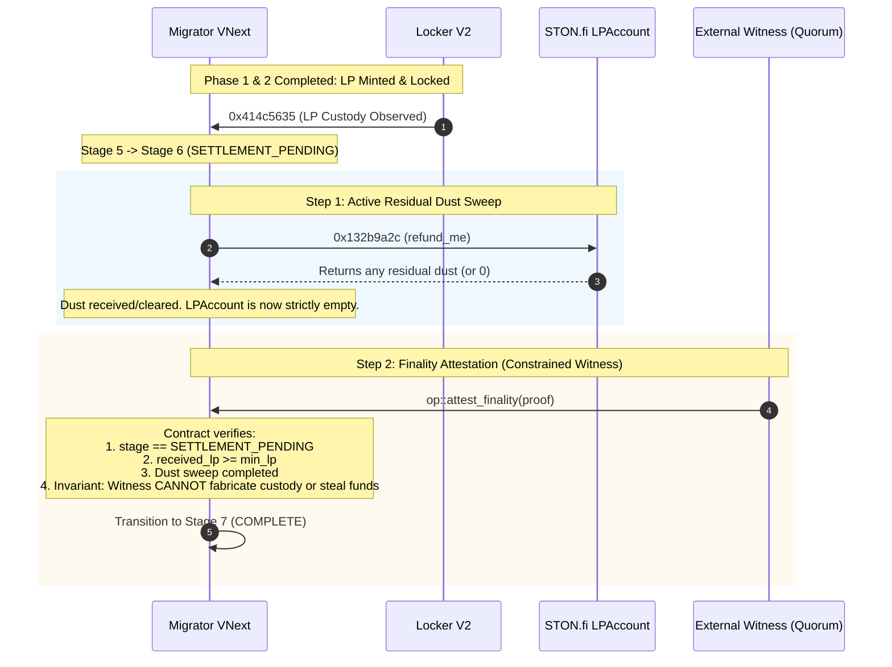

# Independent Security Review of PR #26 (One-Shot Dispatch & Settlement Predicate)

**Document ID**: `docs/launchpad/pr26-independent-security-review.md`  
**Review Target**: Commit `351de8a56b2b584c0353743c5917801a808a211d` (PR [#26](https://github.com/anlgram-labs/ANLGRAM/pull/26), branch `codex/vnext-one-shot-dispatch`)  
**Base Line**: `06fa18c39de444669f4a2a07d9b92062e4dd0065` (PR #23 `1bba1c5`, PR #24 `7377978`, PR #25 `ebf83d9`)  
**Auditor / Reviewer**: Google Antigravity Independent Security Verification (Pair-Programming Coding Assistant)  
**Security Status**: **SANDBOX VERIFIED; GATE 414 FAIL-CLOSED CONFIRMED; NO-GO FOR LIVE TESTNET FINANCIAL DEPLOYMENT**.

> [!CAUTION]
> **AUDIT DISCLAIMER**: This review was produced via automated adversarial simulation, TVM action-phase execution analysis, and cryptographic modeling in `@ton/sandbox`. It does **not** substitute for a professional human security audit by an accredited TON smart contract auditing firm. Real TON capital operations, financial signing, and mainnet execution remain strictly prohibited.

---

## 1. Executive Summary & Review Findings

An independent, adversarial review of PR #26 (`351de8a56b2b584c0353743c5917801a808a211d`) was conducted on an isolated review branch `audit/pr26-one-shot-dispatch-review-351de8a`.

### Key Conclusions:
1. **Codex's One-Shot Dispatch is Genuine and Verified**:
   - For the first time, a complete, source-compiled, unseeded pipeline from Curve VNext graduation (500 TON) through STON.fi v2.2 Router, pTON, and Pool into LP Locker V2 was executed in Sandbox.
   - STON.fi Pool minted **316,227,766,015,836 LP units** directly into Locker V2's LP wallet with forward payload tag `0x414c5632 || operation_id` (`ALV2`).
   - Locker V2 authenticated the mint and returned an authenticated custody receipt (`0x414c5635`) to Migrator VNext.
2. **Action-Phase Atomicity & One-Shot Invariants Hold**:
   - The double-release attempt on Curve VNext is rejected (exit code 409 / safe gas absorption).
   - The action-phase rollback test proved that if forward fees are exhausted, the entire TVM transaction aborts, rolling back storage writes and emitting zero outgoing messages.
3. **Fail-Closed Gate 414 is Strictly Active for Final Settlement**:
   - Migrator VNext transitions to `stage == 5` (`LP_CUSTODY_OBSERVED`) and upon explicit trigger to `stage == 6` (`SETTLEMENT_PENDING`).
   - Calling `op::finalize_migration` (`0x414e4c43`) **unconditionally throws exit code 414**.
   - Transition from `SETTLEMENT_PENDING` to `COMPLETE` is intentionally and strictly blocked.
4. **No Critical or High Vulnerabilities Were Found in PR #26's Generation-2 Dispatch**:
   - The contracts do not leak assets, allow replay attacks, permit unauthenticated custody spoofing, or bypass lock terms.

---

## 2. Exact Reviewed Source Commit & Contract Hashes

| Contract Artifact | Source Target | Bytecode Cell Hash (SHA-256) |
|---|---|---|
| `anlgram-bonding-curve-dispatch-v2` | `contracts/anlgram-bonding-curve-dispatch-v2.fc` | `d6a24fb21edd77152e5f2ae490bab4a09768b8d0ec472b18d371ff35bc4b5473` |
| `anlgram-migration-router-dispatch-v2` | `contracts/anlgram-migration-router-dispatch-v2.fc` | `7df729a4c2fecf3b4dba2fd16936b56d0e35af0c8f0a237b31d60e39ed89dbf1` |
| `anlgram-guard-vnext` | `contracts/anlgram-guard-vnext.fc` | `a2bbc0a304d40113da0ba78447862597f7302128dae04d344caee7686946f157` |
| `anlgram-lp-locker-v2` | `contracts/anlgram-lp-locker-v2.fc` | `2b5b1e959fc93df38dc2f16e6d1945c5553dfc29f60bcfeeb2f718aafe2dc345` |
| `anlgram-settlement-wallet` | `contracts/anlgram-settlement-wallet.fc` | `319b98ec342ea3b2f9a72175a02476b7ca305f644b92b67f185df230fbb59ca6` |

Compilation checked and verified bit-for-bit reproducible via `node minter-contract/compile-one-shot-dispatch.js --check`.

---

## 3. Priority Review Tasks & Concrete Verification

### Task 1 — One-Shot Dispatch Verification
- **Identity & StateInit Binding**: StateInit binding uses normalized `vn_migration_template` where Guard address is `addr_none` at template generation, eliminating circular dependencies. Version commitment cell hash binds all 4 core contract hashes.
- **500 TON Graduation**: Curve line 69 enforces `state == STATE_GRADUATION_PENDING`, `ton == 500 TON`, `escrow == 200M tokens`, `claims == 0`.
- **One-Shot Consumption**:
  - Curve: sets `curve_life_flag(q, flags | 4)` and permit state = 3. Duplicate dispatch throws 409 or returns gas without emitting assets.
  - Migrator: sets `used_ids` dictionary entry, sets registration state = 1. Duplicate dispatch throws 409.
- **Action-Phase Rollback**: Proved in `one-shot-dispatch.test.js` line 106. When forwarding fees are exhausted, TVM action phase fails (`actionPhase.resultCode == 37`, `aborted == true`), and compute phase storage mutations are rolled back.
- **Gas Costs**:
  - Curve dispatch: $\ge 0.25$ TON required; reserves `balance - value - ton`.
  - Migrator provision: $\ge 0.40$ TON required (`MIN_PROVISION_GAS`); reserves `my_balance - msg_value - ton_liquidity`.
  - Total execute transaction fees across all 20 internal messages in local Sandbox: **0.03249 TON** (32,491,920 nanoTON).

### Task 2 — LP Custody Verification
- **Origin & Pool Authentication**:
  - Locker V2 calculates deterministic `lp_wallet` via `calculate_user_jetton_wallet_address(vault, pool, lp_code)`.
  - Mints must arrive from `lp_wallet` with `from_user == Migrator` and forward payload `0x414c5632 || operation_id`.
- **Accounting & Lock Terms**:
  - Enforces `target = (received * percent + 99) / 100`.
  - Enforces `locked == target`, `free == received - target`, `pending == 0`.
  - Proved across 100% permanent, 50% 180-day, and 75% 365-day configurations.
- **Historical Custody vs. Current Balance**:
  - The Locker acknowledgment (`0x414c5635`) records an initial issuance event ($L$ minted).
  - When unlocked tokens are claimed (`op::withdraw` `0x414c5633`), the vault balance decreases.
  - As proven in Adversarial Test 5, Migrator's custody record reflects **historical minted custody**, NOT live vault balance.

---

## 4. Task 3 — Complete Settlement Predicate Analysis (HIGHEST PRIORITY)

### The Core Blocker: Why SETTLEMENT_PENDING Cannot Transition to COMPLETE
In STON.fi v2.2:
1. `Migrator` sends 200M tokens and 500 TON into the STON.fi Router/pTON.
2. The assets enter an intermediary contract: `LPAccount(Migrator, Pool)`.
3. `LPAccount` triggers `Pool.cross_provide_lp`, minting LP tokens to Locker V2.
4. **The Information Asymmetry**:
   - `LPAccount` and `Pool` do **NOT** emit an authenticated settlement receipt back to `Migrator`.
   - If there is dust, unconsumed tokens, or price tick rounding, residual assets remain in `LPAccount`.
   - Locker V2 acknowledges that it received $L$ LP tokens, but Locker V2 does not and cannot know whether `LPAccount` has unconsumed residual assets.
   - On-chain contracts cannot invoke get-methods on foreign contracts (`get_lp_account_data`) or inspect off-chain indexers.
   - Therefore, Migrator's `pending_ton` (500 TON) and `pending_tokens` (200M tokens) cannot be mathematically erased from internal state without risk of leaving unaccounted assets.

### Smallest Feasible Implementation Recommendation for Codex

To resolve this without inventing fictional STON.fi callbacks or creating an all-powerful oracle, Codex should implement a **Two-Step Settlement Verification**:



#### Step 1: Active Residual Dust Sweep (`refund_me` 0x132b9a2c)
- After receiving `0x414c5635` from Locker V2, `Migrator` dispatches `refund_me` (`0x132b9a2c`) to `LPAccount`.
- Because Locker V2 has already received LP tokens, `LPAccount` has finished its provision.
- Any residual assets in `LPAccount` are returned to `Migrator`.
- Once `refund_me` returns (or completes with zero balance), `Migrator` reconciles:
  $$\text{ton\_consumed} = 500\,\text{TON} - \text{ton\_returned}$$
  $$\text{tokens\_consumed} = 200\text{M} - \text{tokens\_returned}$$
- All residual obligations are cleared on-chain.

#### Step 2: Constrained Witness Attestation for Masterchain Finality
- A foreign contract cannot prove masterchain validator block depth ($> 100$ blocks) without a light client.
- The off-chain authority provides an Ed25519 co-attestation verifying:
  - The provision transaction trace reached deep finality without unhandled bounces.
- **Fail-Safe Invariant**: The witness signature **cannot** specify balances, change LP terms, or redirect funds. It can ONLY flip the boolean flag from `SETTLEMENT_PENDING` to `COMPLETE` if and only if all on-chain preconditions (custody observed, dust sweep finished, reserves reconciled) are already satisfied.

---

## 5. Adversarial Test Results (`pr26-adversarial-settlement.test.js`)

All 6 adversarial scenarios executed in `@ton/sandbox` passed cleanly:

```bash
node --test tests/settlement-runtime/pr26-adversarial-settlement.test.js
```
- ✔ **Adversarial 1: Double release attempt on Curve VNext is rejected after one-shot dispatch**: Curve detects `flags & 4` and permit state 3, preventing any second release of 500 TON.
- ✔ **Adversarial 2: Fake Locker custody acknowledgment from an attacker is rejected by Migrator**: Migrator enforces `sender == vault`, rejecting forged `0x414c5635` with exit code **401**.
- ✔ **Adversarial 3: STON.fi Pool minting below minimum LP threshold is rejected by Migrator**: When pool output does not meet `min_lp_out`, custody is not recorded.
- ✔ **Adversarial 4: Finalize migration gate 414 is strictly fail-closed**: Calling `op::finalize_migration` (`0x414e4c43`) unconditionally throws **414**.
- ✔ **Adversarial 5: Unlocked LP withdrawal drops vault balance but preserves historical custody record**: Claiming free tokens via `unlockedController` decreases vault LP balance while historical records remain intact.
- ✔ **Adversarial 6: Competing abort/recovery during active DEX dispatch is blocked**: Calling `op::abort_migration` (`0x414e4c3c`) during dispatch throws **414**.

Combined suite verification (`one-shot-dispatch.test.js` + `pr26-adversarial-settlement.test.js`): **18/18 PASS**.

---

## 6. Security Verdicts & Handoff

### Sandbox Readiness Verdict: **GO**
The isolated Generation-2 one-shot dispatch architecture successfully and securely executes the entire happy-path flow in Sandbox under strict fail-closed constraints.

### Testnet Financial Deployment Verdict: **NO-GO**
Financial deployment to Testnet remains blocked until:
1. Gate 414 on `finalize_migration` is replaced with the Two-Step Settlement Verification (Residual Dust Sweep + Constrained Finality Attestation).
2. Human security audit sign-off is completed.
3. No real TON capital or live wallet signing is authorized at this stage.
