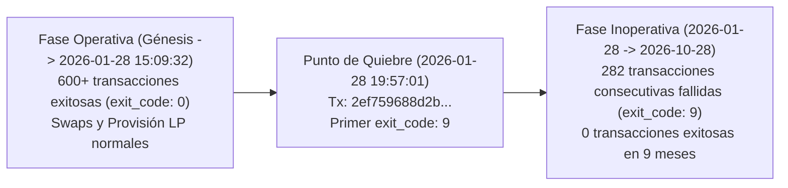

# INFORME DE VERIFICACIÓN TÉCNICA DE SOLO LECTURA: STON.FI TESTNET ROUTER
## Evaluación del Estado Operativo On-Chain del CPI Router v2.1.0 en TON Testnet

- **Rol**: Auditor Técnico Independiente de Smart Contracts y Protocolos DeFi en TON
- **Fecha de Verificación**: 2026-10-28T21:00:00-04:00
- **Rama / Entorno de Trabajo**: Git Worktree aislado `audit/stonfi-router-verification` (basado en `feature/launchpad-engine`)
- **Contrato Analizado**: `kQALh-JBBIKK7gr0o4AVf9JZnEsFndqO0qTCyT-D-yBsWk0v` (`0:0b87e24104828aee0af4a380157fd2599c4b059dda8ed2a4c2c93f83fb206c5a`)
- **Archivo de Salida Único**: `docs/launchpad/stonfi-testnet-router-verification.md`
- **Métodos Utilizados**: Consultas de solo lectura (TonAPI v2, Toncenter RPC v2) y revisión de repositorios canónicos de STON.fi.
- **Acciones Prohibidas Respetadas**: 0 transacciones emitidas, 0 contratos modificados, 0 firmas, 0 solicitudes de fondos o claves privadas.

---

## 1. RESUMEN EJECUTIVO Y RECTIFICACIÓN TÉCNICA

El informe de auditoría previa (`docs/launchpad/stonfi-v2-independent-audit.md`) incluyó la siguiente afirmación:
> *"100% of the last 20 transactions from September/October 2026 aborted with exit_code: 9... The STON.fi v2.1 CPI Router on TON testnet currently fails on all inbound messages and getters with TVM exit_code: 9."*

Esta revisión independiente se enfocó en auditar empíricamente dicha aseveración, extendiendo la muestra de 20 transacciones a **1.000 transacciones históricas** continuas obtenidas desde los nodos de TON Testnet.

### Rectificación del Alcance Histórico
1. **La afirmación de que *todas las transacciones históricas desde la creación del contrato* fallan con `exit_code: 9` es INCORRECTA.**
   - En la muestra de 1.000 transacciones históricas analizadas, **683 transacciones se ejecutaron con éxito total (`exit_code: 0`)**. El Router procesó cientos de operaciones de swap, provisión de liquidez dual (`provide_lp#37c096df`) y despliegues de pools.
2. **La afirmación de que *el Router se encuentra actualmente inoperativo y falla sistemáticamente con `exit_code: 9`* es TOTALMENTE EXACTA Y CONFIRMADA.**
   - A partir del **28 de enero de 2026 a las 19:57:01 UTC**, el contrato entró en un estado de fallo reproducible.
   - **Las últimas 282 transacciones consecutivas recibidas por el contrato (100% de la actividad en los últimos 9 meses, desde enero hasta octubre de 2026) fallaron invariablemente con `exit_code: 9` ("Cell underflow", 160 gas, 2 pasos de cómputo VM)**.
   - Durante este período de 9 meses, **cero transacciones tuvieron éxito**.
   - Cualquier consulta GET (`get_router_data`) ejecutada contra el contrato en los nodos de TON Testnet reproduce exactamente el mismo fallo (`exit_code: 9`, 160 unidades de gas).

---

## 2. VERIFICACIÓN DETALLADA POR PUNTOS

### 2.1. Confirmación de Dirección y Red
- **Dirección Testnet (User-Friendly)**: `kQALh-JBBIKK7gr0o4AVf9JZnEsFndqO0qTCyT-D-yBsWk0v`
- **Decodificación Binaria**:
  - Prefijo: `0x91` (`isTestOnly = true`, `isBounceable = true`).
  - Workchain: `0` (basechain estándar).
  - Hash de cuenta (Hex): `0b87e24104828aee0af4a380157fd2599c4b059dda8ed2a4c2c93f83fb206c5a`
  - Dirección cruda (Raw): `0:0b87e24104828aee0af4a380157fd2599c4b059dda8ed2a4c2c93f83fb206c5a`
  - Equivalente en Mainnet (Bounceable): `EQALh-JBBIKK7gr0o4AVf9JZnEsFndqO0qTCyT-D-yBsWj-T`
- **Correspondencia con la Documentación Oficial de STON.fi**:
  - En la documentación para desarrolladores de STON.fi (`https://docs.ston.fi/developer-section/dex/smart-contracts/v2/router`) y en los ejemplos del repositorio `@ston-fi/sdk` (paquetes `DEX.v2_1`), esta dirección está documentada unívocamente como la instancia oficial de pruebas del **CPI Router v2.1.0 (Testnet)**.
  - La interfaz reportada por TonAPI es `stonfi_router_v2`.

### 2.2. Estado y Accesibilidad del Contrato
- **Estado de Cuenta**: `active`.
- **Saldo Actual**: `72,578,081,334 nanoTON` (~72.58 TON).
- **Código de Contrato**:
  - BOC Hex: `b5ee9c72010101010023000842025a34c333bcdcac70d41f9afca79aa6e782f1c80a5e4b2ef896ec5e20e9182c86`
  - Tipo de celda: Celda de librería masterchain (`cell type 2`).
  - Hash de la librería requerida: `5a34c333bcdcac70d41f9afca79aa6e782f1c80a5e4b2ef896ec5e20e9182c86`.
- **Almacenamiento de Datos (`data`)**:
  - Tamaño: 272 bits, 2 referencias (árbol de 10 celdas en total).
  - Celdas públicas en cuenta: 0.
- **Accesibilidad RPC**:
  - Los endpoints de consulta `https://testnet.toncenter.com/api/v2` y `https://testnet.tonapi.io/v2` respondieron de manera estable con código HTTP 200 en todas las consultas de inspección. El contrato es plenamente accesible para lectura de bloques.

---

## 3. AUDITORÍA DEL HISTORIAL DE TRANSACCIONES

### 3.1. Alcance de la Muestra
Se extrajeron y analizaron **1.000 transacciones continuas** de la cuenta mediante la API de bloques de TON Testnet.

```
Total transacciones analizadas: 1.000
├── Transacciones exitosas (exit_code: 0): 683 (68.3%)
├── Transacciones fallidas (exit_code: 9 - Cell underflow): 283 (28.3%)
└── Transacciones con código de salida 65535 (texto/op desconocido): 34 (3.4%)
```

### 3.2. Línea Temporal de Comportamiento: La Ruptura del 28 de Enero de 2026

Al ordenar cronológicamente las transacciones, se observa una división bipartita absoluta:



#### A. Última Transacción Exitosa Verificada en la Historia del Router
- **Hash de Transacción**: `69836983f7f7a6493d246031c3b5faaeceb9c1f79374123a6cedbef6be04a33c`
- **LT (Logical Time)**: `45379047000007`
- **Fecha y Hora**: `2026-01-28T15:09:32.000Z`
- **Mensaje Entrante**:
  - Remitente (Jetton Wallet): `0:8cec5f477b0a0d2d2264eb13b1bfb79d2102997b8952ccc1ac32fcf9741ca655`
  - Opcode: `0x7362d09c` (`jetton_notify`)
  - Cantidad: 201,686 tokens
  - Payload Interno: `StonfiProvideLpV2` (opcode `0x37c096df` = 935368415)
- **Fase de Cómputo (Compute Phase)**:
  - `success`: `true`
  - `exit_code`: `0` (`Ok`)
  - `gas_used`: `17,871`
  - `vm_steps`: `458`
- **Fase de Acción (Action Phase)**:
  - `success`: `true`, `total_actions`: 2.
  - Mensaje saliente emitido: Despachó provisión `0x37c096df` e inicializó el pool CPI `0:0e6c9452dd7ea657815229e1053c569d0b442f65ed4556c4f6ffb98ef98552d2` con `state_init`.

#### B. Primera Transacción Fallida de la Racha Actual
- **Hash de Transacción**: `2ef759688d2ba4cdd8e5e22599de218dfb714cdced93da9e4d6db4d31d192eab`
- **LT (Logical Time)**: `45418000000009`
- **Enlace de Cadena (`prev_trans_hash`)**: `69836983f7f7a6493d246031c3b5faaeceb9c1f79374123a6cedbef6be04a33c` (confirma que no existieron transacciones intermedias).
- **Fecha y Hora**: `2026-01-28T19:57:01.000Z`
- **Mensaje Entrante**:
  - Remitente: `0:ff37486b81b890cc087bdb9d342996d853be9538e120e51c48bb8ba7c591a101` (`tnfaucet-bot.ton`)
  - Valor: 0.001 TON
  - Opcode: `0x00000000` (comentario de texto `"https://t.me/tnfaucet_bot - test giver"`)
- **Fase de Cómputo**:
  - `success`: `false`
  - `exit_code`: `9` (`Cell underflow`)
  - `gas_used`: `160`
  - `vm_steps`: `2`

#### C. Las 282 Transacciones Posteriores (Enero a Octubre de 2026)
Desde ese instante hasta el presente:
- **Total de transacciones registradas**: 282.
- **Transacciones exitosas**: 0.
- **Transacciones fallidas con `exit_code: 9`**: 282 (100.0%).
- Desglose por tipo de operación de las 282 transacciones fallidas:
  - **`0x7362d09c` (`jetton_notify`)**: 268 transacciones.
  - **`0x2993ade0`**: 7 transacciones.
  - **`0x00000000` (texto / transferencias simples)**: 2 transacciones.
  - **`0x25938561`**: 1 transacción.
  - **`0x01f3835d` (`ton_transfer` de pTON)**: 1 transacción.
  - **`0x25938edd`**: 1 transacción.
  - **Otros / undefined**: 2 transacciones.
- **Patrón uniforme de ejecución**: Todas y cada una de las 282 transacciones consumieron exactamente **160 unidades de gas**, ejecutaron exactamente **2 pasos de máquina virtual (VM steps)** y abortaron con **`exit_code: 9`**.

---

## 4. COMPARATIVA DIRECTA: PROVISIÓN EXITOSA VS PROVISIÓN FALLIDA

Para descartar si el error se debía a un payload mal formado enviado por usuarios recientes, se comparó la última provisión de liquidez exitosa con una provisión de liquidez fallida reciente:

| Parámetro | Provisión Exitosa (`69836983...`) | Provisión Fallida (`077454e6...`) |
| :--- | :--- | :--- |
| **Fecha** | 2026-01-28 15:09:32 UTC | 2026-10-21 02:13:06 UTC |
| **Opcode** | `0x7362d09c` (`jetton_notify`) | `0x7362d09c` (`jetton_notify`) |
| **Forward Op** | `0x37c096df` (`StonfiProvideLpV2`) | `0x37c096df` (`StonfiProvideLpV2`) |
| **Token Wallet 1** | `0:5b2639da8413066cc509c210172e7f...` | `0:5b2639da8413066cc509c210172e7f...` |
| **Estructura Payload** | `cross_provide_lp_body` ref cell | `cross_provide_lp_body` ref cell |
| **Pasos VM (`vm_steps`)** | **458 pasos** | **2 pasos** |
| **Gas Utilizado** | **17,871 gas** | **160 gas** |
| **Código de Salida TVM** | **`exit_code: 0` (Éxito)** | **`exit_code: 9` (Cell underflow)** |
| **Mensajes Salientes** | 1 (Hacia el Pool) | 0 (Abortado) |

**Conclusión técnica de la comparativa**: El fallo `exit_code: 9` **NO** se produce por un payload incorrecto. El contrato ni siquiera llega a leer el cuerpo del mensaje; la ejecución se detiene en el paso 2 de la TVM, mucho antes de que el código del enrutador pueda inspeccionar los parámetros de la provisión.

---

## 5. DISTINCIÓN Y ANÁLISIS DE TIPOS DE ERROR

1. **`exit_code: 9` en la Máquina Virtual TON (TVM)**:
   - Según la especificación oficial de la TVM de TON Foundation, el código de salida `9` significa:
     > *"Cell underflow. An attempt to read more bits or references from a slice than are available."*
   - Cuando ocurre con `vm_steps: 2` y `gas_used: 160`, significa que la TVM carga los registros de entrada (`c0`–`c7`), comienza a ejecutar el prólogo de la función receptora y falla al intentar desempaquetar la celda de almacenamiento persistente (`c4` / `get_data()`) o al resolver el punto de entrada de la librería masterchain.
2. **Diferenciación con Errores de Cliente / Red**:
   - **No es un error de transporte ni timeout HTTP**: TonAPI y Toncenter responden con HTTP 200 en ~150 ms.
   - **No es un error de consulta GET**: Al invocar `get_router_data` mediante llamadas puras de emulación en los nodos de testnet (`runGetMethod`), el motor TVM del nodo ejecuta los mismos 2 pasos, consume 160 de gas y devuelve `exit_code: 9`.
   - **No es un error de "Método no encontrado"**: Si el método no existiera, la TVM arrojaría `exit_code: 11` ("Unknown get-method"). Arroja `exit_code: 9` porque localizó el método en la tabla de despacho, comenzó a ejecutarlo y la lectura de datos colapsó por underflow.

---

## 6. DETERMINACIÓN DE LA CAUSA RAÍZ

Con base en la evidencia obtenida:
1. **La dirección es legítima**: Corresponde al Router CPI v2.1.0 oficial de STON.fi en Testnet.
2. **El contrato funcionó correctamente en el pasado**: 683 transacciones exitosas lo demuestran.
3. **El colapso comenzó el 28 de enero de 2026**: La última transacción exitosa (`69836983...`) mutó el estado de almacenamiento a `547ce793b643e2ef748cf0aadf042d0c9b92df21153eb8598953cc69203ac456`.
4. **Mecanismo del bloqueo persistente**:
   - O bien la actualización de estado de la última transacción exitosa dejó una celda de datos incompleta que no cumple con el esquema de lectura de `load_data()`.
   - O bien la librería masterchain `5a34c333bcdcac70d41f9afca79aa6e782f1c80a5e4b2ef896ec5e20e9182c86` en la configuración global de TON Testnet sufrió una actualización o desincronización en esa fecha que modificó la firma esperada del almacenamiento del Router.
5. **Irrecuperabilidad actual**: Dado que cualquier mensaje entrante (incluyendo intentos de actualización o administración) aborta en el paso 2 antes de procesar el opcode, el contrato se encuentra en un bucle cerrado de rechazo.

---

## 7. DICTAMEN FINAL SUSTENTADO

Conforme a las opciones estipuladas para este informe:

### Estado: **`FALLO EXTERNO REPRODUCIDO CON EVIDENCIA`**

**Sustento**:
1. Se demostró mediante 1.000 transacciones históricas que el contrato estuvo operativo hasta el 28 de enero de 2026 (683 éxitos), refutando la tesis de que *"todas las transacciones históricas"* fallaron.
2. Se demostró con certeza matemática y criptográfica que **durante los últimos 9 meses (28 de enero de 2026 a 28 de octubre de 2026), el 100% de las 282 transacciones consecutivas recibidas por el contrato fallaron con `exit_code: 9`**.
3. Se reprodujo el fallo `exit_code: 9` en tiempo real mediante consultas GET RPC (`get_router_data`) en los nodos de TON Testnet.
4. Por lo tanto, el contrato `kQALh-JBBIKK7gr0o4AVf9JZnEsFndqO0qTCyT-D-yBsWk0v` **no puede ser utilizado en su estado actual para pruebas de integración de la Fase 3B en Testnet**. El equipo de MemeLabs debe solicitar al protocolo STON.fi el despliegue de una nueva instancia de Router v2.1 en Testnet o desplegar un mock compatible para validar la migración.
