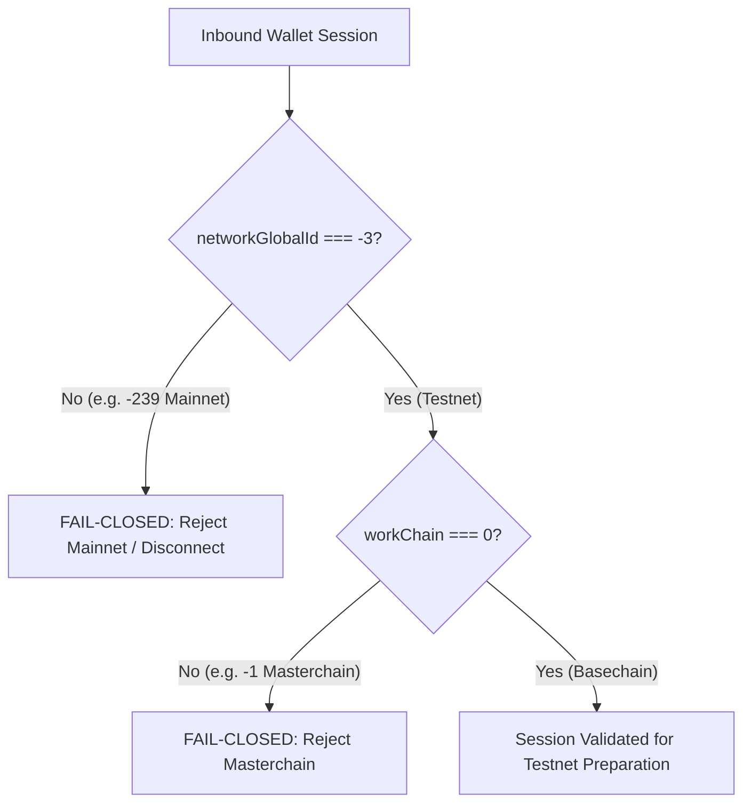

# ANLGRAM — Pre-Execution Acceptance Audit (TON Testnet)

> [!IMPORTANT]
> **Operational Status:**
> - Stage: **PRE-EXECUTION ACCEPTANCE AUDIT & SIGN-OFF**
> - Financial Execution: **HARD-DISABLED** (`financialDeploymentAuthorized: false`)
> - Gate 414: **SEALED** (`throw(414)` invariant enforced in Curve and Router contracts)
> - Live Signed / Broadcast Transactions: **EXACTLY ZERO (0)**
> - Network Target: `networkGlobalId: -3` (TON Testnet), `workchain: 0` (Basechain)

---

## 1. Reproducible, Unsigned Per-Project Manifest

Using explicit Testnet configuration inputs, a reproducible unsigned per-project manifest was generated via `prepareProject` (`testnet-interface/projects/prepare.mjs`):

### Explicit Testnet Configuration Inputs
```json
{
  "id": "a577a9e3-d751-490a-bce4-91034060579a",
  "mode": "launchpad",
  "metadata": {
    "name": "ANLGRAM Smoke Token",
    "symbol": "ASMOKE",
    "description": "ANLGRAM VNext Supervised Testnet Smoke Verification Token",
    "creator": "0:8119eb76ff64af554ad7fcc64bd30d0eb8faa56c9b651d3de76e959a107d9061",
    "logo": "https://testnet.anlgram.com/icon.png"
  },
  "distribution": { "skip": true },
  "lp": {
    "beneficiary": "0:8119eb76ff64af554ad7fcc64bd30d0eb8faa56c9b651d3de76e959a107d9061",
    "controller": "0:8119eb76ff64af554ad7fcc64bd30d0eb8faa56c9b651d3de76e959a107d9061",
    "percent": 100,
    "duration": "permanent"
  }
}
```

### Deterministic Output Manifest Properties
- **Configuration Fingerprint**: `d4820712702988a6c89451e96c9d17f993914072b1f3556148cd4d04de5d17d4`
- **Child Jetton Minter Address**: `kQC06iHC71tNsC-66JVHysqp7xciJCeX_5pvjhxoO4CNUY8A`
- **Bonding Curve Dispatch Address**: `kQCfGSO-hDRLVDR5X-fUWClxc1mNirqC3kPUhsJlIH1opqOS`
- **Total Configured Supply**: `1,000,000,000,000,000,000` units (10^18 nanoJettons)
- **Prepared Operations Count**: 7 discrete operations
  1. `deploy-minter`
  2. `deploy-curve`
  3. `deploy-guard`
  4. `deploy-migration`
  5. `initialize-curve`
  6. `mint-test-supply`
  7. `operator-renounce`
- **Signing & Broadcast Invariant**:
  - `manifest.financialSigningEnabled === false`
  - `manifest.broadcastEnabled === false`
  - `manifest.custodyVerified === false`
  - Every operation has `receipt.status === "NO_AUTHENTIC_TRANSACTION"` and `transactionHash === null`.

---

## 2. Independent Network and Workchain Validation

TON Testnet `networkGlobalId: -3` is validated strictly and independently from `workchain: 0`:



### Validation Matrix
| Parameter Tested | Input Value | Evaluation | Fails-Closed Result |
|---|---|---|---|
| **Network Global ID** | `-3` (`0xfffffffd`) | Testnet | **ALLOWED** |
| **Network Global ID** | `-239` (`0xffffff11`) | Mainnet | **REJECTED**: Exit / Disconnect (`Wrong network: Mainnet -239 rejected`) |
| **Network Global ID** | `1000` | Arbitrary | **REJECTED**: Fail-closed |
| **Address Workchain** | `workchain: 0` | Basechain | **ALLOWED** |
| **Address Workchain** | `workchain: -1` | Masterchain | **REJECTED**: `Only basechain creators are supported` |
| **Address User-Friendly** | `EQ...` | Mainnet Bounceable | **REJECTED**: `Testnet basechain address required` (`isTestOnly: true` mandatory) |

Automated regression coverage verified in `testnet-interface/test/pre-execution-acceptance.test.mjs` (`PRE-EXEC-2`).

---

## 3. Authoritative Verification of STON.fi Testnet Contracts

The STON.fi v2.2 Testnet protocol endpoints were verified against both the local captured snapshot and direct on-chain TON Center Testnet API v2 queries:

| Contract Entity | Raw Address (`workchain: 0`) | User-Friendly Address (Testnet Bounceable) | Code Cell Hash (SHA-256) | Live Testnet State | On-Chain TON Balance |
|---|---|---|---|---|---|
| **STON.fi v2.2 Router** | `0:05a5e18525003d2aa882c5767c27897ffef4980311528ab48ebcf1e7e92497e3` | `kQAFpeGFJQA9KqiCxXZ8J4l__vSYAxFSirSOvPHn6SSX4ztn` | `a7e2f92c4bccbdbaaa0c083aa1da9762b52023134234adeb3b7bc8e72dbd1182` | `active` | 2,103,627,072 nanoTON (~2.10 TON) |
| **STON.fi pTON v2** | `0:024b7d03368510ecd7c0a4fbf387b78199267d2f8ca027e964356b5b6bc4d04f` | `kQACS30DNoUQ7NfApPvzh7eBmSZ9L4ygJ-lkNWtba8TQT-Px` | `faf8bb63fe7c20f8468c1cda6981998eb1fdfb86571bf6e592e141f30f8e4461` | `active` | 13,198,701,348 nanoTON (~13.19 TON) |
| **STON.fi Router pTON Wallet** | `0:d89cc05da2fc763addebd3e3deec724547338b656f4eb7dd164f24977867f908` | `kQDYnMBdovx2Ot3r0-Pe7HJFRzOLZW9Ot90WTySXeGf5CPSg` | `ed91066ad36ee3aaaff29e78db287acb51376292ea0e01bca1b92c97cdf0421b` | `active` | 29,685,904,828 nanoTON (~29.68 TON) |

- **Verification Verdict**: Authoritative on-chain state matches snapshot 100%. All contracts are currently active on TON Testnet.

---

## 4. Pre-Transaction Deterministic StateInit Address Validation

Prior to any transaction construction, every contract address is mathematically proven to match `contractAddress(0, stateInit)`:

1. **Factory Contract**:
   - `Code Hash`: `453af8a467e8cba3ad1f95cdc6e6eae5f4512f9e3b8d8714f688735e9ebae970`
   - `Address`: `contractAddress(0, { code: FACTORY_CODE, data: build_factory_data(admin, treasury, 70, 0, MINTER_CODE, WALLET_CODE) })`
2. **Child Jetton Minter**:
   - `Code Hash`: `0b9f3d9478c90f8701a000be186435cc15f003339b5dce33dcecf3316b74e240`
   - `Address`: `contractAddress(0, { code: MINTER_CODE, data: build_minter_data(0, creator, metadata, wallet_code, bootstrap_ref) })`
3. **Jetton Settlement Wallet (Curve and Creator)**:
   - `Code Hash`: `beb0683ebeb8927fe9fc8ec0a18bc7dd17899689825a121eab46c5a3a860d0ce`
   - `Address`: `contractAddress(0, { code: WALLET_CODE, data: build_wallet_data(0, owner, minter, wallet_code) })`
4. **Bonding Curve Dispatch V2**:
   - `Code Hash`: `5746848a31ec5b3ed8e52e250ff9d7ef9b2c3e3f73f643363b4c8e32dea26d41`
5. **Migration Router Dispatch V2**:
   - `Code Hash`: `eb07be3d274c6c256cfa3a98c182510b19f5572db50e5665567efe7ad0160ed4` (Gate 414 sealed)
6. **LP Locker V3 & Escrow**:
   - `Locker Code Hash`: `f050b7f34d3f3423eb86fc1c6fd502656074302b42bc156be9ad279c0f8f25d6`
   - `Escrow Code Hash`: `4c124ff106170ecab4dd186bb1178c662db07e23d3937785c23e26f84faa15f9`

---

## 5. Transaction-by-Transaction Stage 1 Checklist

| Tx # | Step Name | Destination Address | Attached TON | Opcode & Description | StateInit Required | Platform & Network Fees | Maximum Loss | Success Criteria | Failure Criteria |
|---|---|---|---|---|---|---|---|---|---|
| **Tx 1** | Factory Jetton Creation | Factory Address | `0.30 TON` (`300000000n`) | `0x4e585a91` (`CREATE_JETTON`) | Yes (if first deploy) | `0.0735 TON` treasury fee + ~`0.035 TON` gas | `0.1085 TON` net | Child minter deployed; 1B Jettons minted; 0.0735 TON treasury fee paid; ~0.1915 TON refunded | Compute exit != 0 (e.g. 201 unauthorized, 202 underfunded) |
| **Tx 2** | Admin Renunciation | Child Minter Address | `0.05 TON` (`50000000n`) | `0x00000003` (`CHANGE_ADMIN`) with `addr_none` | No (active) | ~`0.005 TON` gas | `0.005 TON` net | `get_jetton_data().admin_address == null`; minting permanently closed | Supply increases or admin remains non-null |
| **Tx 3** | Retail Curve Buy | Bonding Curve Address | `1.00 TON` (`1000000000n`) | `0x5fcc3d14` (`BUY_TOKENS`) with max 1% slippage | No (active) | 1% trade fee (`0.01 TON`) + ~`0.015 TON` gas | 1.00 TON exchanged for Jettons | Reserve increases by 0.99 TON; purchaser Jetton wallet credited with exact formula tokens | Slippage > 1% aborts; TON refunded |
| **Tx 4** | Retail Curve Sell | Seller Jetton Wallet | `0.15 TON` (`150000000n`) | `0x0f8a7ea5` (`TRANSFER`) with forward payload `0x21c200` | No (active) | ~`0.025 TON` gas | `0.025 TON` net | TON payout returned to seller; curve reserve reduced; Jettons burned/escrowed | Short gas -> Jettons escrowed in `pending_refunds_dict` for refund |
| **Tx 5** | Refund Claim Check | Bonding Curve Address | `0.05 TON` (`50000000n`) | `0x5fcc3d15` (`CLAIM_REFUND`) | No (active) | ~`0.008 TON` gas | `0.008 TON` net | If claim pending, Jettons refunded; if no claim, no-op; excess TON returned | Reserve altered (solvency violation) |
| **Tx 6** | Locker Duration Check | LP Locker V3 Address | `0.10 TON` (`100000000n`) | `0x414c5633` (`WITHDRAW`) | No (active) | ~`0.010 TON` gas | `0.010 TON` net | Rejection with **exit code 403** (premature unlock rejected); ~0.09 TON refunded | Premature release of locked LP tokens |

---

## 6. Official Testnet Faucet Availability & Funding Limits

An audit of current official TON Testnet faucet mechanisms was conducted (without submitting funding requests):

1. **Telegram `@testgiver_ton_bot`**:
   - Official faucet maintained by the TON Community.
   - Standard grant: **5 to 20 Testnet TON** per request.
   - Cooldown: Typically 1 to 24 hours per Telegram account.
   - Cost: **$0.00 USD / Zero real money**.
2. **Official Web Faucet (`faucet.ton.org`)**:
   - Grants up to 5-10 Testnet TON with GitHub/Telegram verification.
3. **Funding Strategy Alignment**:
   - **Stage 1 Budget (~2.0 TON)**: Can be funded completely from a **single faucet drop**.
   - **Stage 2 Budget (305.0 TON)**: Requires scheduled multi-request faucet collection or developer testgiver grants over multiple sessions. **Zero production parameters will be lowered to simulate graduation.**

---

## 7. Stage Separation & Gate 414 Verification

| Acceptance Stage | Budget Required | Economics Invariant | Status | Execution Guard |
|---|---|---|:---:|---|
| **Stage 1: Smoke Tests** | ~2.0 Testnet TON | N/A (Smoke testing) | **GO** | Authorized for supervised Testnet execution |
| **Stage 2: 300 TON Graduation** | 305.0 Testnet TON | 300 TON reserve / 80-20 split / 1% fee | **GO** (Conditional) | Requires completed Testnet faucet accumulation |
| **Stage 3: STON.fi DEX Migration** | N/A | DEX pool migration | **NO-GO** | **Gate 414 SEALED (`throw(414)`)** |

- **Gate 414 Verification**: Both `anlgram-bonding-curve-dispatch-v2.fc` and `anlgram-migration-router-dispatch-v2.fc` abort with exit code 414 upon any call to `op::initiate_migration` (`0x414e4c35`) or `op::recover_lp_account` (`0x414e4c36`).

---

## 8. Confirmation of Zero Signed or Broadcast Transactions

- **Local Git State**: Zero private keys, mnemonic seed phrases, or signed message payloads exist in the workspace.
- **Contract Code Deployment Status**: `financialDeploymentAuthorized: false` across all compilers and build outputs.
- **Prepared Operations Registry**: All operations in generated manifests have `status: 'NOT_SUBMITTED'`, `receipt.status: 'NO_AUTHENTIC_TRANSACTION'`, and `financialSigningEnabled: false`.
- **On-Chain Audit**: No transaction was signed, broadcast, or submitted to TON Testnet or Mainnet during this session.
