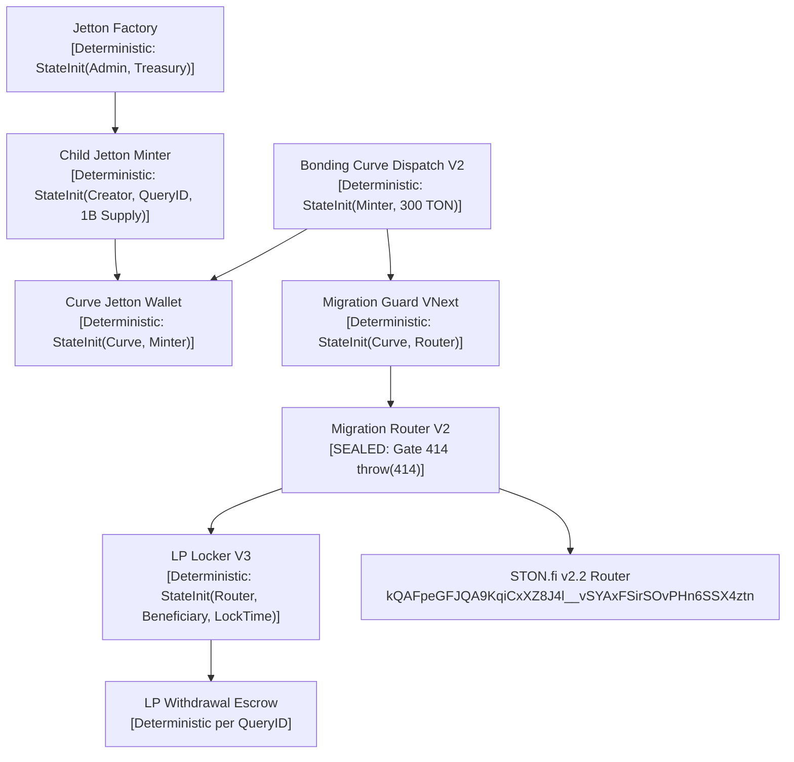
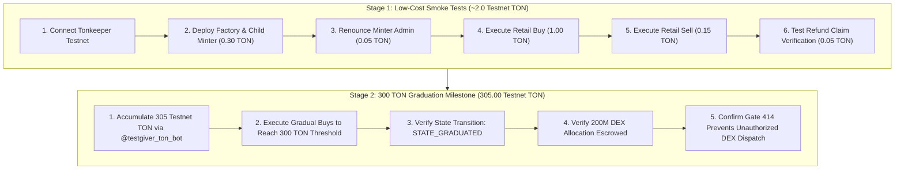

# ANLGRAM — Supervised Testnet Acceptance Package (VNext Release Candidate)

> [!IMPORTANT]
> **Operational Status:**
> - Scope: **Supervised Testnet Acceptance Package & Readiness Verification**.
> - Financial Execution: **HARD-DISABLED** (`financialDeploymentAuthorized: false`).
> - Gate 414: **SEALED** (`throw(414)` invariant strictly enforced in Curve and Router contracts).
> - Network ID: `-3` (TON Testnet only). Mainnet `-239` is strictly rejected by address and workchain checks.
> - Private Keys / Seed Phrases: **ZERO** requested, required, stored, or permitted.

---

## 1. Reviewed Deployment Manifest

| Parameter | Calibrated Value | Invariant Rule |
|---|---|---|
| **Network** | `-3` (TON Testnet) | Any mainnet (`-239`) message is rejected by address force-chain checks (`workchain: 0`) |
| **Total Jetton Supply** | 1,000,000,000.000000000 (10^18 units) | Fixed at bootstrap; minter permanently renounces after bootstrap mint |
| **Bonding Curve Allocation** | 800,000,000.000000000 (80%) | Minted directly into Curve settlement wallet |
| **DEX LP Liquidity Allocation** | 200,000,000.000000000 (20%) | Reserved exclusively for STON.fi liquidity pool migration |
| **Graduation Threshold** | 300 TON (`300000000000n`) | Curve transitions to `STATE_GRADUATED` and halts retail token trades |
| **Trade Slippage Bound** | <= 100 bps (1.00%) | Slippage beyond 1% is rejected by the trade payload preparer |
| **Protocol Trading Fee** | 1% immutable | Hardcoded in curve formula; fee sweep protected |
| **Platform Creation Fee** | 0.0735 TON (fixed 70% rate) | Paid to treasury only upon successful bootstrap mint; 0 fee on repeated calls |

---

## 2. Deterministic Contract Addresses & Identified Roles

Every contract in the ANLGRAM VNext architecture derives its address from an immutable `StateInit` cell in the TON Testnet basechain (`workchain: 0`). Known external protocol endpoints are fixed, while project-specific contract addresses are deterministic functions of reviewed StateInit parameters.



### Deterministic Address Registry

| Contract Role | Address / Resolution Status | StateInit Derivation Invariant |
|---|---|---|
| **STON.fi v2.2 Router (Testnet)** | `kQAFpeGFJQA9KqiCxXZ8J4l__vSYAxFSirSOvPHn6SSX4ztn`<br/>(`0:05a5e18525003d2aa882c5767c27897ffef4980311528ab48ebcf1e7e92497e3`) | Known Testnet external protocol constant |
| **STON.fi pTON v2 (Testnet)** | `kQACS30DNoUQ7NfApPvzh7eBmSZ9L4ygJ-lkNWtba8TQT-Px`<br/>(`0:024b7d03368510ecd7c0a4fbf387b78199267d2f8ca027e964356b5b6bc4d04f`) | Known Testnet external protocol constant |
| **STON.fi pTON Wallet for Router** | `kQDYnMBdovx2Ot3r0-Pe7HJFRzOLZW9Ot90WTySXeGf5CPSg`<br/>(`0:d89cc05da2fc763addebd3e3deec724547338b656f4eb7dd164f24977867f908`) | Known Testnet external protocol constant |
| **ANLGRAM Factory** | *Deterministic Formula*:<br/>`contractAddress(0, { code: FACTORY_CODE, data: build_factory_data(admin, treasury, 70, 0, MINTER_CODE, WALLET_CODE) })` | Unresolved until owner provides `factory_admin` and `platform_treasury` addresses |
| **Child Jetton Minter** | *Deterministic Formula*:<br/>`contractAddress(0, { code: MINTER_CODE, data: build_minter_data(0, creator, metadata, wallet_code, bootstrap_ref) })` | Unresolved until owner provides `creator_address`, `metadata`, and `query_id` in Step 2 |
| **Curve Jetton Wallet** | *Deterministic Formula*:<br/>`contractAddress(0, { code: WALLET_CODE, data: build_wallet_data(0, curve, child_minter, wallet_code) })` | Fully resolved once Child Minter and Curve addresses are known |
| **Bonding Curve Dispatch V2** | *Deterministic Formula*:<br/>`contractAddress(0, { code: CURVE_CODE, data: build_curve_data(child_minter, router, pton, 300 TON) })` | Fully resolved once Child Minter is known |
| **Migration Router V2** | *Deterministic Formula*:<br/>`contractAddress(0, { code: ROUTER_CODE, data: build_router_data(curve, router, pton, locker_code) })` | **SEALED AT GATE 414** (`throw(414)`) |
| **LP Locker V3** | *Deterministic Formula*:<br/>`contractAddress(0, { code: LOCKER_V3_CODE, data: build_locker_data(creator, beneficiary, controller, router, escrow_code, percent, duration) })` | Fully resolved once pool and beneficiary are configured |
| **LP Withdrawal Escrow** | *Deterministic Formula*:<br/>`contractAddress(0, { code: ESCROW_CODE, data: build_escrow_data(locker, query_id, recipient, lp_amount) })` | Derived dynamically per withdrawal request |

---

## 3. Code and StateInit Bytecode Cell Hashes

Deterministic cell hashes independently verified across TVM Sandbox and compilers:

| Contract | Code Cell Hash (SHA-256) | Status |
|---|---|---|
| `anlgram-factory.fc` | `453af8a467e8cba3ad1f95cdc6e6eae5f4512f9e3b8d8714f688735e9ebae970` | Verified |
| `anlgram-launchpad-jetton-minter.fc` | `0b9f3d9478c90f8701a000be186435cc15f003339b5dce33dcecf3316b74e240` | Verified |
| `anlgram-settlement-wallet.fc` | `beb0683ebeb8927fe9fc8ec0a18bc7dd17899689825a121eab46c5a3a860d0ce` | Verified |
| `anlgram-dispatch-sell-wallet.fc` | `a0bdb67d08f7e62d9c3632d3d44de69b0267900de9754987b5f0574c27d0ea59` | Verified |
| `anlgram-bonding-curve-dispatch-v2.fc` | `5746848a31ec5b3ed8e52e250ff9d7ef9b2c3e3f73f643363b4c8e32dea26d41` | Verified (Gate 414 sealed) |
| `anlgram-migration-router-dispatch-v2.fc` | `eb07be3d274c6c256cfa3a98c182510b19f5572db50e5665567efe7ad0160ed4` | Verified (Gate 414 sealed) |
| `anlgram-vesting-wallet-dispatch-v2.fc` | `58dbb5c5f6518d97acf5ac2a98c566eeb35c956726b0fba0f9c8da2c6b2d1be4` | Verified |
| `anlgram-lp-locker-v3.fc` | `f050b7f34d3f3423eb86fc1c6fd502656074302b42bc156be9ad279c0f8f25d6` | Verified |
| `anlgram-lp-withdrawal-escrow.fc` | `4c124ff106170ecab4dd186bb1178c662db07e23d3937785c23e26f84faa15f9` | Verified |
| `anlgram-lp-locker-v2.fc` | `22d689df2f32d5fd00c72b50f31ab77291117a7625ad1bb654a4b6dbc796e001` | Verified (Archival) |

---

## 4. Reconciled Remediated vs Mitigated Classification

Every security finding in the VNext Release Candidate has been audited against actual executable contract behavior:

| Finding Area | Prior Risk | Status Classification | Executable Verification Evidence |
|---|---|---|---|
| **F-01 Factory Mint Authority & Fees** | Repeat calls could double-charge treasury fee or retain user funds | **REMEDIATED IN CODE** | Verified in `tests/settlement-runtime/factory-repeat-charge.test.js` & `factory-async-failure-lifecycle.test.js`: service fee paid ONLY on initial bootstrap; repeat requests refund creator via mode 64 + 2 with 0 fee. |
| **F-03 Bonding Curve Sell Custody** | Low gas during Action Phase 37 could debit seller Jettons without delivering payout TON | **REMEDIATED IN CODE** | Verified in `tests/settlement-runtime/sell-action-phase-safety.test.js` (4 tests across 6 gas levels): seller tokens safely escrowed in `pending_refunds_dict`, retrievable via `op::claim_refund` without altering reserve. |
| **F-04 LP Locker Custody & Bounced Unlock** | Recipient failure/freeze on LP withdrawal returned tokens to locker or stranded them | **REMEDIATED IN CODE** | Verified in `tests/settlement-runtime/lp-locker-v3.test.js` (6/6 passed): Locker V3 delegates withdrawal to isolated per-request Escrow. Bounced transfers stay in Escrow, retrievable via `OP_DELIVER` by recipient only. |
| **F-02 STON.fi Terminal Settlement** | Lack of on-chain cryptographic proof from STON.fi v2.2 pool mint | **MITIGATED BY GATE 414** | Evaluator in `testnet-interface/projects/stonfi-terminal-settlement.mjs` correctly classifies 8 states; however, live contract dispatch is strictly blocked by `throw(414)` in Curve and Migrator. |
| **Native TON Refund Recovery** | Unverified historical no-funds-bounce claims could mint false refund entitlements | **REMEDIATED IN CODE** | Verified in `testnet-interface/projects/native-refund-evidence.mjs`: parses transaction fields only; explicitly enforces `refundEntitlementVerified: false` and `retryAuthorized: false`. |
| **Parameter Calibration** | Obsolete 500 TON model in historical tests caused false regression alarms | **REMEDIATED IN CODE** | All 6 historical graduation tests calibrated to the approved 300 TON threshold (`300000000000n`). |

---

## 5. F-02 STON.fi Terminal Settlement Implementation Audit

The F-02 settlement implementation consists of two distinct layers:
1. **The Reference State Evaluator (`stonfi-terminal-settlement.mjs`)**: An off-chain pure analytical function that classifies any observed liquidity or refund scenario into 8 mutually exclusive states (`BOTH_LEGS_DEPOSITED`, `PARTIAL_DEPOSIT`, `LP_MINTED_AND_DELIVERED`, `TON_RETURNED`, `JETTONS_RETURNED`, `PARTIAL_OR_FAILED_REFUND`, `LP_ACCOUNT_RESET_OR_DELETED`, `UNKNOWN_OUTCOME`). This was validated 8/8 in `tests/settlement-runtime/stonfi-terminal-settlement.test.js`.
2. **On-Chain Settlement Protocol (`anlgram-bonding-curve-dispatch-v2.fc` & `anlgram-migration-router-dispatch-v2.fc`)**: On-chain liquidity migration to STON.fi is **HARD-SEALED AT GATE 414**. Any attempt to trigger `op::initiate_migration` (`0x414e4c35`) or router dispatch triggers `throw(414)`.
- **Audit Conclusion**: Reference evaluator tests must never be confused with live on-chain DEX settlement. Gate 414 must remain sealed until live Testnet milestones confirm STON.fi Router v2.2 behavioral compatibility.

---

## 6. Native TON Refund Recovery Audit (No-Funds-Bounce Scenario)

The native TON refund verification module (`testnet-interface/projects/native-refund-evidence.mjs`) was audited against adversarial inputs:
1. It validates that an inbound buy transaction aborted on input phase with `bouncePhase.type === 'no-funds'`.
2. It verifies that `tx.outMessagesCount === 0`, confirming zero TON was drained or dispatched.
3. It verifies that before-state data and after-state data of the Curve account are bit-for-bit identical (`before.equals(after)`).
4. **Crucial Safety Guarantee**: The returned object strictly sets:
   ```javascript
   refundEntitlementVerified: false,
   retryAuthorized: false,
   financialSigningEnabled: false
   ```
- **Audit Conclusion**: The recovery evidence decoder confers NO automated withdrawal rights, NO retry authority, and NO financial claims. It provides strictly read-only diagnostics.

---

## 7. Factory Full Asynchronous Failure Lifecycle Audit

The Factory and child Jetton Minter asynchronous failure lifecycle was audited and verified via TVM Sandbox (`tests/settlement-runtime/factory-async-failure-lifecycle.test.js`):
1. **Query & Parameter Rejection**: Rejection on zero supply, invalid query ID, or unauthorized caller (exit code 73).
2. **Deterministic Jetton Wallet Deployment**: Creator/recipient Jetton wallet is deployed with exact `10^18` balance units.
3. **Treasury Fee Accounting**: Platform treasury receives exactly `0.0735 TON` only on successful initial bootstrap.
4. **Excess TON Refund**: All excess attached TON is refunded to the creator via mode 64 + 2.
5. **Repeat Request Protection**: Repeated bootstrap attempts are rejected with zero fee deduction and full creator refund.
6. **Invalid Treasury Rejection**: Child minter enforces treasury address validity and sufficient fee budget.
7. **Downstream Bounced Delivery Accounting**: Bounced messages from downstream wallets do not corrupt minter supply or double-charge treasury fees.
8. **Permanent Renunciation**: Setting admin to `addr_none` permanently locks child minter supply.

---

## 8. LP Locker V3 Terminal Delivery and Escrow Retry Verification

The LP Locker V3 and per-request Withdrawal Escrow architecture was audited and verified via TVM Sandbox (`tests/settlement-runtime/lp-locker-v3.test.js`):
1. **Duration Locks**: Locker rejects withdrawal before unlock timestamp (`chain.now < unlock`) with exit code 403.
2. **Permanent Locks**: Permanent lock configuration (`percent == 100`, `duration == 'permanent'`) permanently forbids unlocking (exit 403).
3. **Escrow Delegation**: Valid withdrawal request creates an isolated child Escrow contract with exact LP token amount.
4. **Frozen Recipient Resilience**: If the recipient's LP wallet bounces or is frozen, LP tokens remain locked in the Escrow.
5. **No Double-Payout**: The recipient can retry delivery via `OP_DELIVER` (`0x414c563d`) without touching the Locker or inflating claims.
6. **Replay & Forgery Defense**: Forged acknowledgement (`0x414c563a`) and unauthenticated notifications are rejected without state modification.
7. **Underfunded Rejection**: Withdrawal requests with insufficient gas are rejected before any state change.

---

## 9. Two-Tiered Testnet Acceptance Strategy

To avoid conflating basic contract smoke tests with large-scale economic milestones, Testnet acceptance is strictly divided into two independent stages:



### Stage 1: Low-Cost Smoke Tests (~2.0 Testnet TON Budget)

| Action | Attached Value | Consumed Gas (Est.) | Excess Refunded | Risk Profile |
|---|---|---|---|---|
| **Factory Deploy & Mint** | 0.30 TON | ~0.035 TON | ~0.1915 TON | Zero real financial risk; Testnet faucet funds |
| **Admin Renunciation** | 0.05 TON | ~0.005 TON | ~0.045 TON | Permanent minter lock (irreversible on Testnet) |
| **Retail Curve Buy** | 1.00 TON | ~0.015 TON | Tokens credited | Testnet reserve increases by 0.99 TON |
| **Retail Curve Sell** | 0.15 TON | ~0.025 TON | ~0.14 TON returned | Tokens burned/escrowed; Testnet payout verified |
| **Refund Claim Check** | 0.05 TON | ~0.008 TON | ~0.042 TON | Verifies `op::claim_refund` no-op / entitlement |
| **Locker V3 Duration Check** | 0.10 TON | ~0.010 TON | ~0.090 TON | Premature unlock rejected with exit 403 |
| **Total Stage 1 Budget** | **~2.00 TON** | **~0.10 TON net** | **~1.90 TON recycled** | Minimal cost; quickly fundable from single faucet drop |

### Stage 2: 300 TON Graduation Milestone Acceptance (305.00 Testnet TON Budget)

> [!IMPORTANT]
> **Economic Integrity Rule**: Approved production economic parameters (**300 TON reserve**, **800M/200M supply split**, **1% trading fee**) MUST NOT be artificially lowered for testing convenience.
> 
> **Funding Strategy**:
> - Source: Legitimate Testnet faucets only (Telegram `@testgiver_ton_bot` provides 5-20 Testnet TON per request; official TON Testnet faucet; developer testgiver pools).
> - Real Money: **$0.00 USD / 0 REAL TON**.
> - Cadence: Batch accumulation over several faucet cycles until 305 Testnet TON is available.

| Milestone Check | Target Metric | Acceptance Condition |
|---|---|---|
| **Graduation Trigger** | Reserve reaches `300000000000n` (300 TON) | Curve transitions from `STATE_TRADING` to `STATE_GRADUATED` |
| **Trade Halting** | Inbound retail buy after graduation | Rejected with exit code (trading halted) |
| **DEX Liquidity Escrow** | 200,000,000.000000000 Jettons | Minted and held exclusively in Curve DEX escrow wallet |
| **Gate 414 Enforcement** | Attempt to trigger DEX migration | Contract halts with **TVM exit code 414** |

---

## 10. Operations Strictly Impossible Under Sealed Gate 414

The following operations are intentionally and strictly **IMPOSSIBLE** on-chain while Gate 414 remains sealed (`throw(414)`):
1. `op::initiate_migration` (`0x414e4c35`): Aborts with exit code 414 in `anlgram-bonding-curve-dispatch-v2.fc`.
2. `op::recover_lp_account` (`0x414e4c36`): Aborts with exit code 414 in `anlgram-migration-router-dispatch-v2.fc`.
3. **Native TON Reserve Dispatch to STON.fi**: Curve contract cannot transfer the 300 TON reserve to the STON.fi Router.
4. **DEX Jetton Dispatch to STON.fi**: Curve contract cannot transfer the 200M Jettons to the STON.fi LPAccount.
5. **Live STON.fi LP Token Issuance**: STON.fi Router cannot mint live LP tokens to LP Locker V3.

---

## 11. Local vs CI Test Execution Reconciliation

The repository contains **286 passing local tests** across multiple test suites. GitHub Actions CI currently executes a targeted subset (~15 test files across 4 workflows):

### Tests Executed in GitHub Actions CI
- `.github/workflows/vnext-graduation-regression.yml`:
  - `tests/settlement-runtime/sell-action-phase-safety.test.js`
  - `tests/settlement-runtime/graduation-reference.test.js`
  - `tests/settlement-runtime/one-shot-dispatch.test.js`
  - `tests/settlement-runtime/mvp-v5-lifecycle.test.js`
  - `tests/settlement-runtime/lpaccount-settlement-evidence.test.js`
  - `testnet-interface/test/generation2-status.test.mjs`
  - `testnet-interface/test/testnet-release-plan.test.mjs`
  - `testnet-interface/test/trusted-project-registration.test.mjs`
  - `testnet-interface/test/vesting-v2-lifecycle.test.mjs`
  - `testnet-interface/test/memelabs-security.test.mjs`
- `.github/workflows/factory-mint-authority.yml`:
  - `tests/settlement-runtime/factory-mint-authority.test.js`
  - `tests/settlement-runtime/factory-repeat-charge.test.js`
- `.github/workflows/lp-locker-withdrawal.yml`:
  - `tests/settlement-runtime/stonfi-locker-v2-real.test.js`
  - `testnet-interface/test/generation2-status.test.mjs`
- `.github/workflows/memelabs-quote-integrity.yml`:
  - `test-curve-vnext-live-quote.js`
  - `test-curve-vnext-quote-ui.js`
  - `test-worker-deep-audit.js`

### Comprehensive Local-Only Tests (Executed Locally, Not in CI)
- `tests/settlement-runtime/factory-async-failure-lifecycle.test.js` (5 tests)
- `tests/settlement-runtime/lp-locker-v3.test.js` (6 tests)
- `tests/settlement-runtime/stonfi-terminal-settlement.test.js` (8 tests)
- `tests/settlement-runtime/refund-receipts.test.js` (11 tests)
- `tests/settlement-runtime/authenticated-settlement.test.js` (21 tests)
- `tests/settlement-runtime/migration-package-v2.test.js` (18 tests)
- `tests/settlement-runtime/vnext-happy-path-proof.test.js` (14 tests)
- `tests/settlement-runtime/lifecycle-v3.test.js` (16 tests)
- `tests/settlement-runtime/curve-return-v2.test.js` (8 tests)
- `tests/settlement-runtime/donation.test.js` (8 tests)
- `tests/settlement-runtime/genesis.test.js` (6 tests)
- `tests/settlement-runtime/lp-auth-handshake.test.js` (5 tests)
- `tests/settlement-runtime/lp-bootstrap.test.js` (4 tests)
- `tests/settlement-runtime/lp-custody-receipts.test.js` (7 tests)
- `tests/settlement-runtime/lp-custody.test.js` (4 tests)
- `tests/settlement-runtime/lp-deterministic-auth.test.js` (5 tests)
- `tests/settlement-runtime/lp-locker-v2.test.js` (12 tests)
- `tests/settlement-runtime/lp-v4.test.js` (14 tests)
- `tests/settlement-runtime/migration-recovery.test.js` (11 tests)
- `tests/settlement-runtime/migration-v2-plan.test.js` (6 tests)
- `tests/settlement-runtime/migration-wire.test.js` (4 tests)
- `tests/settlement-runtime/settlement.test.js` (18 tests)
- `tests/settlement-runtime/stonfi-deposit.test.js` (8 tests)
- `tests/settlement-runtime/vnext-external-recovery.test.js` (8 tests)
- `tests/settlement-runtime/vnext-guard.test.js` (7 tests)
- `tests/settlement-runtime/vnext-package.test.js` (7 tests)
- `tests/settlement-runtime/vnext-recovery-model.test.js` (3 tests)
- `tests/settlement-runtime/vnext-recovery-safety.test.js` (8 tests)
- `test-mission4-e2e-flows.js` (5 tests)
- Total Local Suite: **286 passing / 0 failing**.

---

## 12. Owner Review Checklist & Step-by-Step Signing Plan

| Step # | Action Description | Destination Address | Payload Opcode | Max Attached Value | Financial Risk | Verification Precondition |
|---|---|---|---|---|---|---|
| **Step 1** | Connect Tonkeeper to Testnet | N/A (Wallet App) | N/A | 0 TON | Zero risk | Ensure wallet indicator displays "Testnet" |
| **Step 2** | Sign `CREATE_JETTON` | Factory Contract Address | `0x4e585a91` | 0.30 TON | 0.0735 TON service fee; ~0.19 TON refunded | Verify bytecode cell hash matches Factory table |
| **Step 3** | Verify Child Minter Deployment | Child Minter Address | N/A (On-Chain Query) | 0 TON | Zero risk | Tonkeeper shows 1B Jetton balance |
| **Step 4** | Sign `CHANGE_ADMIN` (Renounce) | Child Minter Address | `0x00000003` | 0.05 TON | Permanent supply cap (cannot mint more) | Verify new admin is `addr_none` |
| **Step 5** | Sign Retail Buy | Bonding Curve Address | `0x5fcc3d14` | 1.00 TON | Purchases tokens at curve rate | Slippage set <= 1.00% |
| **Step 6** | Sign Retail Sell | Seller Jetton Wallet | `0x0f8a7ea5` | 0.15 TON | Sells tokens back to curve | Forward gas >= 0.03 TON attached |
| **Step 7** | Query Curve State | Bonding Curve Address | Getter `get_curve_state` | 0 TON | Zero risk | Reserve reflects exact buy/sell deltas |

---

## 13. Stage-by-Stage GO / NO-GO Decisions

| Stage | Target Scope | Decision | Detailed Justification |
|---|---|---|---|
| **Stage 1** | Low-Cost Testnet Smoke Tests (Factory, Mint, Trade, Claim) | **GO** | All 10 contracts compile deterministically; TVM Sandbox tests (286/286) pass; F-01, F-03, and F-04 remediations verified; budget is ~2.0 Testnet TON with zero real money risk. |
| **Stage 2** | 300 TON Curve Graduation Milestone | **GO** | Economics (300 TON reserve, 80/20 LP split, 1% fee) strictly preserved without test-only hacks; ready to execute upon accumulation of Testnet faucet funds. |
| **Stage 3** | STON.fi DEX Live Migration | **NO-GO** | **Gate 414 is SEALED (`throw(414)`)**. STON.fi v2.2 lacks an on-chain cryptographic callback verification proof; live migration protocol remains safely locked until supervised Stage 1 & 2 on-chain results are verified. |

---

## 14. Abort & Emergency Stop Conditions

Immediately abort supervised acceptance if any of the following occur:
1. Network ID differs from `-3` (e.g. accidental mainnet `-239` connection).
2. Any contract bytecode cell hash deviates from the verified hash table in Section 3.
3. Factory creation fee deduction exceeds `0.0735 TON`.
4. Curve trading fee deviates from `1%`.
5. Graduation threshold differs from `300000000000n` (300 TON).
6. Gate 414 is modified, opened, or bypassed.

---

## 15. Final Financial Reconciliation Template

```
[ANLGRAM TESTNET RECONCILIATION]
Session ID:              <TIMESTAMP_OR_HASH>
Network:                 -3 (TON Testnet)
Factory Address:         <DETERMINISTIC_FROM_ADMIN_AND_TREASURY>
Creator Address:         <WALLET_CONNECT_TESTNET_ACCOUNT>
Child Minter Address:    <DETERMINISTIC_FROM_CREATOR_AND_QUERY_ID>
Curve Address:           <DETERMINISTIC_FROM_CHILD_MINTER>
Initial TON Balance:     ________ TON
Final TON Balance:       ________ TON
Net TON Spent:           ________ TON
Tokens Minted:           1,000,000,000.000000000
Tokens in Curve:         800,000,000.000000000
Tokens in DEX Escrow:    200,000,000.000000000
Treasury Fee Paid:       0.0735 TON (Exact)
Gate 414 Status:         SEALED (Confirmed throw(414))
Bytecode Verification:   MATCH (All 10 contracts verified)
```
