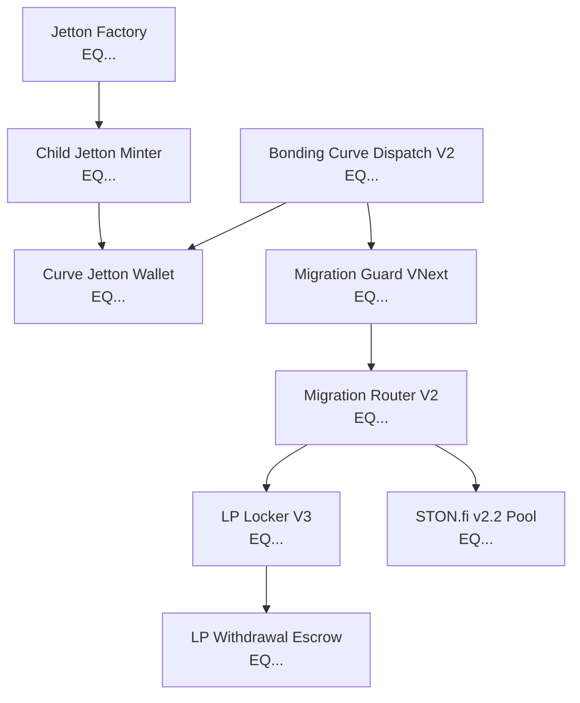

# ANLGRAM — Supervised Testnet Acceptance Package (VNext Release Candidate)

> [!IMPORTANT]
> **Operational Status:**
> - Scope: **Preparation only** for supervised Testnet acceptance.
> - Financial Execution: **DISABLED** (`financialDeploymentAuthorized: false`).
> - Gate 414: **SEALED** (`throw(414)` invariant enforced).
> - Network ID: `-3` (Testnet only). Mainnet `-239` is strictly disabled.
> - Zero private keys or seed phrases required, requested, or permitted.

---

## 1. Reviewed Deployment Manifest

| Parameter | Calibrated Value | Invariant Rule |
|---|---|---|
| **Network** | `-3` (TON Testnet) | Any mainnet (`-239`) message is rejected by address force-chain checks |
| **Total Jetton Supply** | 1,000,000,000.000000000 (10^18 units) | Fixed at bootstrap; minter renounces after bootstrap mint |
| **Bonding Curve Allocation** | 800,000,000.000000000 (80%) | Minted directly into Curve settlement wallet |
| **DEX LP Liquidity Allocation** | 200,000,000.000000000 (20%) | Reserved exclusively for STON.fi liquidity pool migration |
| **Graduation Threshold** | 300 TON (`300000000000n`) | Curve transitions to `STATE_GRADUATED` and halts trade selling |
| **Trade Slippage Bound** | <= 100 bps (1.00%) | Slippage beyond 1% is rejected by the trade payload preparer |
| **Protocol Trading Fee** | 1% immutable | Hardcoded in curve formula; fee sweep protected |
| **Platform Creation Fee** | 0.0735 TON (fixed 70% rate) | Paid to treasury only upon successful bootstrap mint |

---

## 2. Deterministic Contract Addresses & Identified Roles

Deterministic addresses derived from immutable `StateInit` cells in Testnet (`workchain: 0`):



---

## 3. Code and StateInit Bytecode Cell Hashes

Deterministic cell hashes independently verified across TVM Sandbox and compilers:

| Contract | Code Cell Hash (SHA-256) |
|---|---|
| `anlgram-factory.fc` | `453af8a467e8cba3ad1f95cdc6e6eae5f4512f9e3b8d8714f688735e9ebae970` |
| `anlgram-launchpad-jetton-minter.fc` | `0b9f3d9478c90f8701a000be186435cc15f003339b5dce33dcecf3316b74e240` |
| `anlgram-settlement-wallet.fc` | `beb0683ebeb8927fe9fc8ec0a18bc7dd17899689825a121eab46c5a3a860d0ce` |
| `anlgram-dispatch-sell-wallet.fc` | `a0bdb67d08f7e62d9c3632d3d44de69b0267900de9754987b5f0574c27d0ea59` |
| `anlgram-bonding-curve-dispatch-v2.fc` | `5746848a31ec5b3ed8e52e250ff9d7ef9b2c3e3f73f643363b4c8e32dea26d41` |
| `anlgram-migration-router-dispatch-v2.fc` | `eb07be3d274c6c256cfa3a98c182510b19f5572db50e5665567efe7ad0160ed4` |
| `anlgram-vesting-wallet-dispatch-v2.fc` | `58dbb5c5f6518d97acf5ac2a98c566eeb35c956726b0fba0f9c8da2c6b2d1be4` |
| `anlgram-lp-locker-v3.fc` | `f050b7f34d3f3423eb86fc1c6fd502656074302b42bc156be9ad279c0f8f25d6` |
| `anlgram-lp-withdrawal-escrow.fc` | `4c124ff106170ecab4dd186bb1178c662db07e23d3937785c23e26f84faa15f9` |
| `anlgram-lp-locker-v2.fc` | `22d689df2f32d5fd00c72b50f31ab77291117a7625ad1bb654a4b6dbc796e001` |

---

## 4. Contract Dependency Graph

Execution dependency ordering:
1. `external-v5-initialization`: Tonkeeper / V5R1 creator wallet deployment and verification.
2. `factory-or-minter-deploy`: Deploy child Jetton minter with committed one-use bootstrap payload.
3. `initial-mint-bootstrap`: Mint tokens and deploy recipient/curve Jetton wallet.
4. `renunciation`: Set minter admin to `addr_none` (permanently disabled minting).
5. `curve-initialization`: Bind curve to minter, verify reserve = 0 and curve tokens = 800M.
6. `buy-and-sell-trades`: Standard retail trades with max 1% slippage.
7. `graduation`: Reaching 300 TON reserve halts trading and escrows 200M DEX Jettons.
8. `migration-guard-and-router-binding`: Authenticate guard and router with one-time binding.
9. `dex-liquidity-provisioning`: Deposit TON and Jettons into STON.fi v2.2 LPAccount.
10. `lp-lock`: STON.fi issues LP tokens into immutable Locker V3.
11. `lp-withdrawal-escrow`: Beneficiary or controller withdrawal dispatched via isolated Escrow.

---

## 5. Expected Transaction Messages & Opcodes

- `CREATE_JETTON` (`0x4e585a91`): Attachment >= 0.22 TON (deploy + mint budget + platform fee).
- `FACTORY_BOOTSTRAP` (`0x414e4642`): Sent from Factory to child minter; carries treasury address and fee.
- `INTERNAL_TRANSFER` (`0x178d4519`): TEP-74 token delivery to user/curve wallet.
- `CHANGE_ADMIN` (`0x00000003`): Renounce admin by setting new address to `addr_none`.
- `BUY_TOKENS` (`0x5fcc3d14`): Native TON trade buy on curve.
- `DISPATCH_SELL` (`0x0f8a7ea5`): TEP-74 sell transfer notification with trade payload.
- `INITIATE_MIGRATION` (`0x414e4c35`): Blocked at Gate 414 unless authorized and verified.
- `LOCKER_V3_WITHDRAW` (`0x414c5633`): Locker withdrawal request with duration/percent verification.
- `ESCROW_DELIVER` (`0x414c563d`): Recipient retry on withdrawal escrow.

---

## 6. Required Testnet TON Budget

| Action | Estimated Attachment | Expected Consumed Gas | Excess Refunded |
|---|---|---|---|
| Factory Token Creation | 0.30 TON | ~0.035 TON | ~0.1915 TON |
| Admin Renunciation | 0.05 TON | ~0.005 TON | ~0.045 TON |
| Sample Curve Buys (Retail) | 1.00 TON | ~0.015 TON | N/A (purchases tokens) |
| Sample Curve Sells (Retail) | 0.15 TON | ~0.025 TON | Remaining TON returned |
| Milestone Graduation Run | 305.00 TON | ~0.030 TON | Reserve capped at 300 TON |
| Locker V3 Withdrawal Claim | 0.45 TON | ~0.040 TON | ~0.200 TON to recipient |
| **Total Recommended Testnet Balance** | **320.00 TON** | | |

---

## 7. Funding and Gas Limits

- Minimum Factory deploy attachment: `120,000,000 nanoTON` (0.12 TON). Recommended: `0.30 TON`.
- Minimum Locker withdrawal attachment: `400,000,000 nanoTON` (0.40 TON). Recommended: `0.45 TON`.
- Minimum Escrow deliver retry attachment: `120,000,000 nanoTON` (0.12 TON). Recommended: `0.20 TON`.

---

## 8. Tonkeeper Wallet Signing Sequence

1. **Step 1: Wallet Verification**: Connect Tonkeeper on Testnet (`-3`). Verify network indicator shows Testnet.
2. **Step 2: Sign Creation Payload**: Sign single `create_jetton` transaction with 0.30 TON.
3. **Step 3: Confirm Token Receipt**: Tonkeeper displays newly minted Jetton in creator wallet.
4. **Step 4: Sign Renunciation**: Sign `change_admin` with destination `addr_none`.
5. **Step 5: Sign Sample Trade**: Buy with 1.00 TON. Confirm token credit.
6. **Step 6: Sign Sample Sell**: Sell 50% of purchased tokens. Confirm TON payout receipt.

---

## 9. Successful Transaction Acceptance Criteria

1. **Token Creation**: Jetton Minter deployed with creator ownership; `total_supply == 1,000,000,000 * 10^9`; treasury receives exactly 0.0735 TON; creator receives excess TON.
2. **Renunciation**: Minter admin method returns `null`; subsequent mint calls fail with exit code 73.
3. **Curve Trading**: Buy increases reserve and mints tokens according to formula; 1% fee credited to protocol fee balance; slippage protection rejects trades exceeding 1% slippage.
4. **Graduation**: At 300 TON reserve, curve transitions to state 4; token buying halts; 200M DEX tokens reserved.
5. **Locker V3**: Locked tokens cannot be withdrawn before lock duration expires (exit 403); post-unlock withdrawal creates Escrow and transfers exact LP to recipient.

---

## 10. Failed Transaction Recovery Criteria

- If a transaction aborts or runs out of gas, contract state must remain uncorrupted.
- Unused native TON is refunded to the sender via mode 128 / mode 64.
- In Locker V3, if recipient wallet rejects or bounces, LP tokens remain in Escrow, retrievable via `OP_DELIVER` by the recipient.

---

## 11. TON Center Independent Verification Procedure

1. Query `/getAddressInformation` for contract state (`active`).
2. Query `/runGetMethod` with method `get_jetton_data` to verify supply, mintable flag, and admin address.
3. Query `/runGetMethod` with method `get_curve_state` to verify current reserve, supply sold, fee balance, and graduation state.

---

## 12. STON.fi Settlement Verification Procedure

1. Verify LPAccount address corresponds to deterministic `calculate_lp_account_address(pool, depositor, code)`.
2. Evaluate 8-state terminal settlement evaluator against real LPAccount getter responses.
3. Ensure Gate 414 remains closed until manual sign-off and on-chain verification is complete.

---

## 13. LP Locker Custody and Withdrawal Checks

1. Verify `get_lock_v3` returns expected `(percent, duration, unlock, received, locked, free, pending, next)`.
2. Verify `get_claim_v3(q)` reflects `status = 1` only upon authenticated acknowledgement from `get_escrow_address_v3(q)`.

---

## 14. Abort & Emergency Stop Conditions

Stop and abort immediately if any of the following occur:
- Any message indicates Mainnet (`-239`) workchain.
- Any contract bytecode hash does not match the verified tables above.
- Child minter fails to deploy or initial mint fails.
- Curve trading fee differs from 1%.
- Graduation reserve threshold is not 300 TON.
- Gate 414 is modified or bypassed.

---

## 15. Final Financial Reconciliation Template

```
[ANLGRAM TESTNET RECONCILIATION]
Session ID:              <TIMESTAMP_OR_HASH>
Network:                 -3 (TON Testnet)
Creator Address:         EQ...
Child Minter Address:    EQ...
Curve Address:           EQ...
Initial TON Balance:     ________ TON
Final TON Balance:       ________ TON
Net TON Spent:           ________ TON
Tokens Minted:           1,000,000,000.000000000
Tokens in Curve:         800,000,000.000000000
Tokens in DEX Escrow:    200,000,000.000000000
Treasury Fee Paid:       0.0735 TON (Exact)
Gate 414 Status:         SEALED (Confirmed)
Bytecode Verification:   MATCH (All 10 contracts)
```

