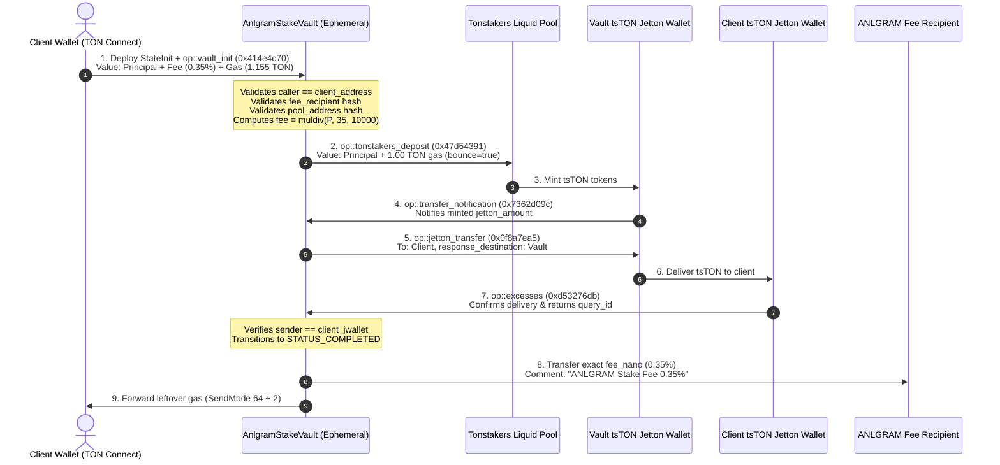

# ANLGRAM StakeVault & Staking System — Security Audit Package

**Repository**: [anlgram-labs/ANLGRAM](https://github.com/anlgram-labs/ANLGRAM)  
**Production URL**: [https://anlgram.com](https://anlgram.com)  
**Staking Interface**: [https://anlgram.com/staking.html](https://anlgram.com/staking.html)  
**Document Classification**: Smart Contract Audit Preparation  
**Target Audience**: Independent Smart Contract Security Auditors (CertiK, SlowMist, TonTech) & Technical Stakeholders  

---

## 1. System Overview & Scope

ANLGRAM provides an enterprise-grade staking and intelligence interface for the TON blockchain. The staking system allows users to stake TON into the official liquid staking protocol (**Tonstakers / liquidTF**) and receive liquid **tsTON** tokens, while collecting an exact platform fee of 35 basis points (0.35%) in TON.

### 1.1 Source Files in Scope

| Component | Source Path | Language / Runtime | Purpose |
| :--- | :--- | :--- | :--- |
| **StakeVault Contract** | `minter-contract/contracts/anlgram-stake-vault.fc` | FunC (`#pragma version >=0.2.0`) | Ephemeral isolated single-deposit vault deployed per client stake. Escrows fee, forwards principal to Tonstakers, routes tsTON, and pays fee only upon client receipt confirmation. |
| **Staking Router Contract** | `minter-contract/contracts/anlgram-staking-router.fc` | FunC (`#pragma version >=0.2.0`) | Multi-client non-custodial escrow and fee router with per-client on-chain accounting dictionaries. |
| **Contract Includes** | `minter-contract/contracts/imports/stdlib.fc` | FunC | Standard TON FunC standard library. |
| **Client Staking Engine** | `assets/js/staking.js` | JavaScript (ES2022 / Browser) | Orchestrates TON Connect transactions, StateInit construction, Jetton Wallet resolution, on-chain verification, and UI updates. |
| **Wallet Connector** | `assets/js/wallet-connect.js` | JavaScript (ES2022 / Browser) | Integrates `@tonconnect/ui` v2, manifest origin validation, and address formatting. |
| **Staking Frontend UI** | `staking.html` | HTML5 / CSS | Deposit modal, terms confirmation, 5-stage transaction tracker, portfolio view, and history table. |
| **Compiled Artifacts** | `minter-contract/build/*.compiled.json` | JSON | Bytecode BoC base64, hex, and SHA-256 code cell hashes. |

---

## 2. Architecture & Operational Flows

### 2.1 The 1-Vault-Per-Deposit Architecture (`AnlgramStakeVault`)

To eliminate the risks of multi-tenant token co-mingling, cross-client race conditions, and FIFO mismatch in asynchronous TVM processing, ANLGRAM utilizes an **Isolated Stake Vault** model for client deposits:

1. **Deterministic Deployment**: Each stake transaction deterministically deploys a new `AnlgramStakeVault` via a single atomic TON Connect message with embedded `StateInit(codeCell, initialDataCell)`.
2. **Dedicated Jetton Wallet**: The vault owns its unique tsTON Jetton Wallet (`vault_jwallet_address`), ensuring that no two depositors ever share Jetton balances.
3. **Two-Phase Escrow Fee Collection**:
   - The platform fee (0.35%) is locked inside the Vault at initialization.
   - The fee is **never released** until the client's own tsTON Jetton Wallet confirms physical receipt of minted tsTON via `op::excesses` (`0xd53276db`).
4. **Full Bounce Protection**: If Tonstakers bounces or rejects the deposit, 100% of the principal + 100% of the fee is refunded to the client (0 fee charged).
5. **Non-Destruction Invariant**: The Vault remains in `STATUS_COMPLETED` (status = 4) rather than self-destructing (`SUICIDE` / mode 128+32), ensuring any late or delayed tokens can be forwarded to the client.

---

### 2.2 Unstaking Flow (Withdrawals)

ANLGRAM charges **zero fee (0%)** on unstaking, withdrawals, and reward claims:
- **Interface**: Handled in `staking.html` via `UnstakeModalController.executeUnstake()` in `assets/js/staking.js`.
- **Target Contract**: Sent directly to the client's own tsTON Jetton Wallet (`pos.jettonWalletAddress`).
- **Opcode**: Standard NEP-74 Jetton Burn opcode `op::burn` (`0x595f07bc`).
- **Message Value**: 1.05 TON (`UNSTAKE_GAS_RESERVE_NANO`), attached for burn processing and pool payout.
- **Recipient**: The user's TON wallet receives TON principal and accrued staking yield directly from Tonstakers. ANLGRAM's contracts are not in the unstaking critical path.

---

## 3. Platform Fee Specification

### 3.1 Mathematical Calculation
- **Fee Rate**: Exactly 35 basis points (0.35%).
- **Integer Math**: Enforced on-chain using 64/128-bit integer arithmetic:
  $$\text{fee\_nano} = \text{muldiv}(\text{principal\_nano}, 35, 10000)$$
- **Precision**: Computed in nanoTON ($10^{-9}\text{ TON}$). No floating-point operations.
- **Rounding**: Truncated towards zero (rounded down to nanoTON).

### 3.2 Verification Examples
| Principal TON | Principal nanoTON | Fee Calculation | Fee nanoTON | Fee TON |
| :--- | :--- | :--- | :--- | :--- |
| **1 TON** | `1,000,000,000` | $(10^9 \times 35) / 10000$ | `3,500,000` | `0.0035 TON` |
| **10 TON** | `10,000,000,000` | $(10^{10} \times 35) / 10000$ | `35,000,000` | `0.0350 TON` |
| **100 TON** | `100,000,000,000` | $(10^{11} \times 35) / 10000$ | `350,000,000` | `0.3500 TON` |
| **1,000 TON** | `1,000,000,000,000` | $(10^{12} \times 35) / 10000$ | `3,500,000,000` | `3.5000 TON` |

### 3.3 Fee Recipient
- **Friendly Address**: `UQDW_PsjmeOBB_fvzOFmwqW7redEcufKQgImyrURvO7dbSYd`
- **Raw Address**: `0:d6fcfb2399e38107f7efcce166c2a5bbade74472e7ca420226cab511bceedd6d`
- **Workchain**: `0` (Basechain)
- **On-Chain Enforcement**: The contract asserts `fee_hash == const::authorized_fee_recipient_hash()` (`0xd6fcfb2399e38107f7efcce166c2a5bbade74472e7ca420226cab511bceedd6d`), throwing `error::unauthorized_fee_recipient` (`412`) if tampered with.

---

## 4. Smart Contract Code Hashes & Compiler Environment

### 4.1 Compiler Configuration
- **Compiler Library**: `@ton-community/func-js` version `^0.11.0` (Node.js WebAssembly compiler).
- **Core SDK**: `@ton/core` version `^0.63.1`, `@ton/ton` version `^16.3.0`.
- **Target Pragma**: `#pragma version >=0.2.0;`
- **Compilation Script**: `minter-contract/compile-stake-vault.js` and `minter-contract/compile-staking-router.js`.

### 4.2 Code Cell Hashes (SHA-256)
- **`AnlgramStakeVault`**:
  - Source: `minter-contract/contracts/anlgram-stake-vault.fc`
  - Code Cell Hash (Hex): `e69f7d22756c31ef01965ac197e3c561c77ab25d496795f0d4fdc9f2502daccf`
  - Code BOC Size: 1,844 bytes (Base64 length: 2,460 chars)
  - Compiled Artifact: `minter-contract/build/anlgram-stake-vault.compiled.json`
- **`AnlgramStakingRouter`**:
  - Source: `minter-contract/contracts/anlgram-staking-router.fc`
  - Code Cell Hash (Hex): `1d21bbaebf3601577c4dc1dd2e8296d691edcec13d6c38fb26d5b8b884f5af6a`
  - Code BOC Size: 3,579 bytes (Base64 length: 4,772 chars)
  - Compiled Artifact: `minter-contract/build/anlgram-staking-router.compiled.json`

---

## 5. Security Invariants & Guarantees

1. **Non-Custodial Guarantee**: Neither ANLGRAM administrators nor third parties possess any function or opcode allowing extraction of client principal, staked tokens, or escrowed funds.
2. **Deterministic Attribution**: In `AnlgramStakeVault`, all outgoing transfers (`op::tonstakers_deposit`, `op::jetton_transfer`, bounce refunds) hardcode the destination addresses directly from immutable initial storage.
3. **Delivery Before Fee Release**: Fee release requires physical receipt confirmation (`0xd53276db`) originating specifically from `client_jwallet_address`.
4. **Replay & Collision Protection**: Every transaction utilizes a unique 64-bit `query_id` (derived from timestamp) and strict `network_id` assertion (`-239` on Mainnet, `-3` on Testnet).
5. **No Self-Destruct Risk**: Vaults never call `send_raw_message` with mode 128 (destroy contract).

---

## 6. Questions for Independent Security Auditors

The following targeted questions are prepared for accredited auditing firms reviewing this codebase:

1. **Two-Phase Excess Handling (`0xd53276db`)**:
   - In `anlgram-stake-vault.fc` lines 375-434, the vault validates `equal_slices(sender_address, client_jwallet_address) & (in_query_id == query_id)` before transitioning to `STATUS_COMPLETED` and releasing the 0.35% fee. Does this guarantee that malicious or forged `0xd53276db` messages cannot prematurely trigger fee collection?
2. **Asynchronous Gas Sizing**:
   - The gas allocations are: `pool_deposit_gas = 1.00 TON`, `jetton_transfer_gas = 0.105 TON`, `storage_reserve = 0.05 TON`. Are these margins sufficient across heavy network congestion periods on TON Mainnet to prevent out-of-gas compute phase failures?
3. **Late Token Recovery via `op::vault_rescue` (0x414e4c72)**:
   - If a network partition or RPC timeout drops the initial `0x7362d09c` transfer notification, the client can invoke `op::vault_rescue`. Can this function be exploited under any edge condition to mint, double-spend, or re-route tsTON?
4. **Storage Rent Longevity**:
   - With an immutable storage reserve of 0.050 TON and an initial storage footprint of ~1,600 bits across 3 cells, what is the estimated duration before storage rent depletion on the TON Basechain?
5. **Bounce Handler Coverage**:
   - In `handle_bounce` (lines 196-258), both Tonstakers deposit bounces and Jetton wallet transfer bounces are handled. Is there any unhandled bounce vector (e.g., fee payment bounce) that could leave the contract in an unrecoverable state?
